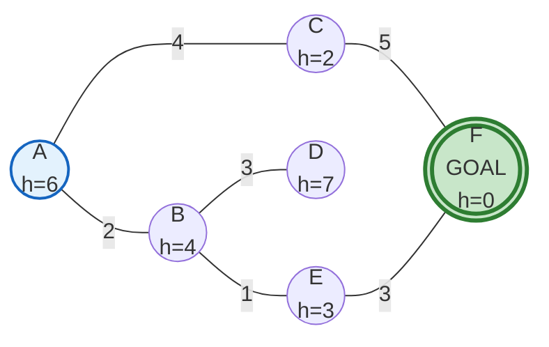
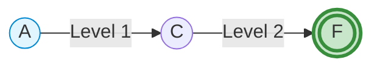
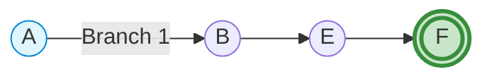
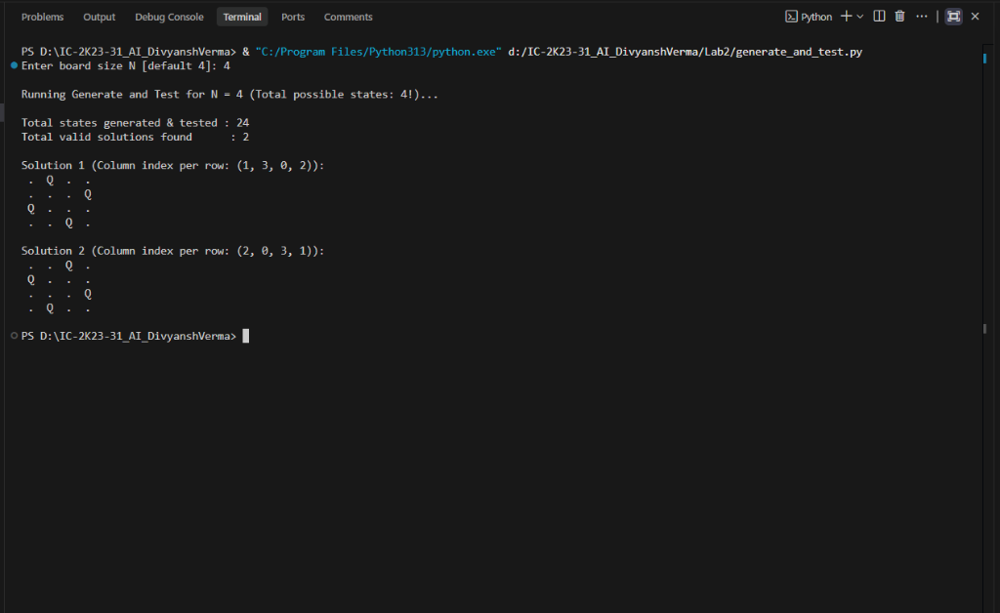
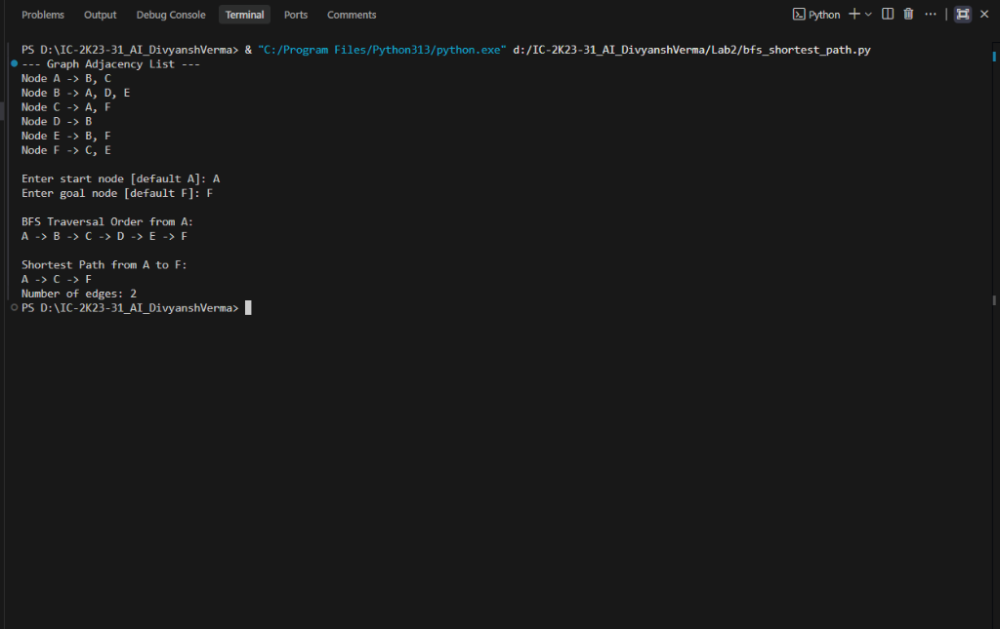
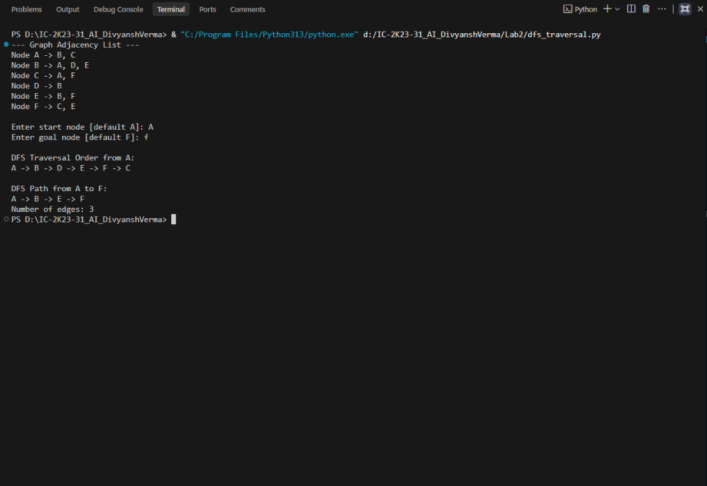
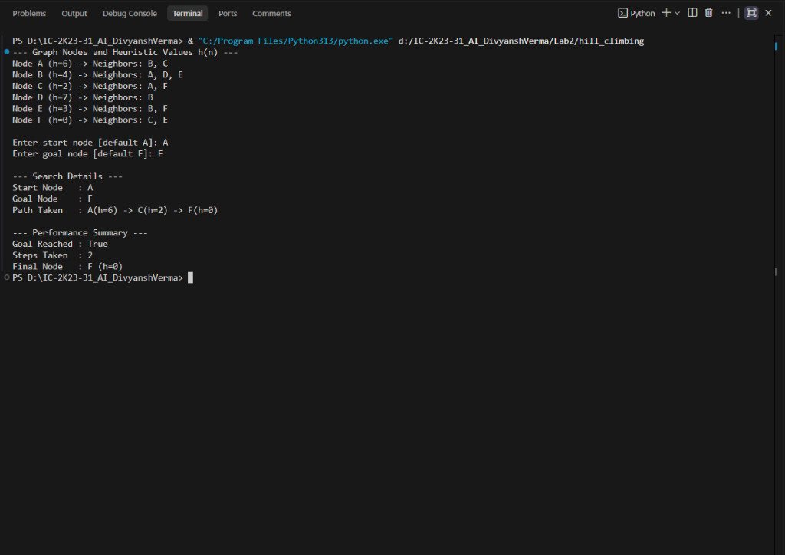
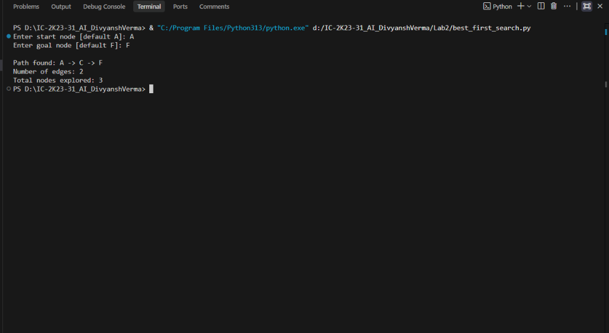
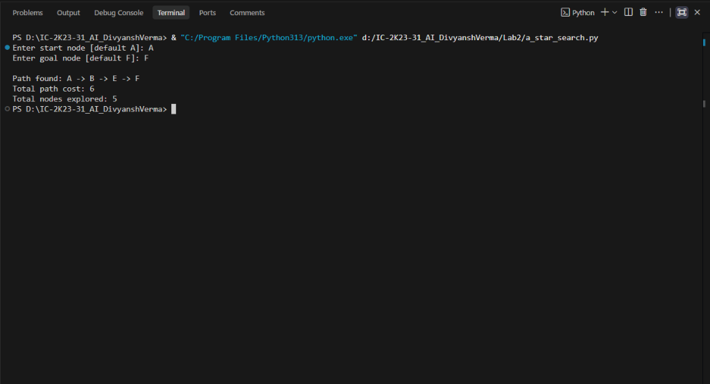

# Lab 2 – Implementation of AI Search Algorithms

**Course:** Artificial Intelligence Lab (IC-703 C / IC-709D)  
**Lab Number:** 2  
**Student:** Divyansh Verma  
**Roll Number:** IC-2K23-31  
**Repository:** [IC-2K23-31-AI-Divyansh_Verma](https://github.com/divyanshv123/IC-2K23-31-AI-Divyansh_Verma)  
**Programming Language:** Python 3

---

## Table of Contents

1. [Aim](#1-aim)
2. [Introduction](#2-introduction)
3. [Problem Formulation & Shared Graph Topology](#3-problem-formulation--shared-graph-topology)
4. [Generate and Test (4-Queens)](#4-generate-and-test-4-queens)
5. [Breadth-First Search (BFS)](#5-breadth-first-search-bfs)
6. [Depth-First Search (DFS)](#6-depth-first-search-dfs)
7. [Hill Climbing Search](#7-hill-climbing-search)
8. [Best-First Search (Greedy BFS)](#8-best-first-search-greedy-bfs)
9. [A-Star Search (A*)](#9-a-star-search-a)
10. [Consolidated Comparative Analysis](#10-consolidated-comparative-analysis)
11. [Results & Performance Metrics](#11-results--performance-metrics)
12. [Screenshots and Visualizations](#12-screenshots-and-visualizations)
13. [How to Run](#13-how-to-run)
14. [Learning Outcomes](#14-learning-outcomes)
15. [Conclusion](#15-conclusion)

---

# 1. Aim

To study and implement the fundamental Artificial Intelligence search algorithms in Python according to the Unit 2 syllabus:

1. **Generate and Test Search** (Constraint satisfaction via permutation testing)
2. **Breadth-First Search (BFS)** (Uninformed level-by-level traversal)
3. **Depth-First Search (DFS)** (Uninformed deep branch exploration)
4. **Hill Climbing Search** (Informed local search using heuristics)
5. **Best-First Search** (Greedy informed search using priority queues)
6. **A-Star Search ($A^*$)** (Optimal informed search combining path cost and heuristic estimate)

The objective is to understand how each algorithm navigates a state space, selects candidate states, handles frontiers, and converges towards a goal.

---

# 2. Introduction

Search algorithms form the computational backbone of Artificial Intelligence problem solving. When an intelligent agent cannot reach a solution in a single direct step, it must explore a graph or tree of alternative possibilities.

AI search strategies are divided into two fundamental paradigms:

### 2.1 Uninformed (Blind) Search
These algorithms have no domain-specific knowledge about how close a given state is to the target. They only know how to generate legal moves and test whether a state is the goal.
- **Generate and Test:** Brute-force generation of candidate states followed by constraint verification.
- **Breadth-First Search (BFS):** FIFO queue-based exploration that guarantees the shallowest path.
- **Depth-First Search (DFS):** LIFO stack-based exploration that dives deeply before backtracking.

### 2.2 Informed (Heuristic) Search
These algorithms utilize problem-specific knowledge encapsulated in a **heuristic evaluation function $h(n)$**, which estimates the cost or distance from node $n$ to the goal.
- **Hill Climbing:** Local greedy choice that moves to the neighbor with the best heuristic score, terminating at local extrema.
- **Best-First Search:** Global heuristic exploration prioritizing nodes strictly with the lowest $h(n)$ via a priority queue.
- **A-Star ($A^*$):** Evaluates nodes using $f(n) = g(n) + h(n)$, combining actual cost expended ($g$) with estimated remaining cost ($h$) to guarantee finding the lowest-cost path.

---

# 3. Problem Formulation & Shared Graph Topology

To establish a fair benchmark, the graph search algorithms (BFS, DFS, Hill Climbing, Best-First Search, and $A^*$) operate on a consistent, connected graph topology with defined edge weights and heuristic estimates to destination **Goal `F`**.

### 3.1 Network Graph Architecture



### 3.2 Heuristic Function Table $h(n)$

The heuristic represents straight-line or estimated remaining cost to reach destination **`F`**:

| Node $n$ | Heuristic $h(n)$ | Adjacency / Neighbors |
|:---:|:---:|---|
| **A** | 6 | `B (cost 2)`, `C (cost 4)` |
| **B** | 4 | `A (cost 2)`, `D (cost 3)`, `E (cost 1)` |
| **C** | 2 | `A (cost 4)`, `F (cost 5)` |
| **D** | 7 | `B (cost 3)` |
| **E** | 3 | `B (cost 1)`, `F (cost 3)` |
| **F (Goal)** | 0 | `C (cost 5)`, `E (cost 3)` |

---

# 4. Generate and Test (4-Queens)

## 4.1 Concept & Working

The **Generate and Test** strategy separates candidate generation from validation:
1. **Generate:** Systematically produce candidate state permutations where each row has exactly one queen in a distinct column ($N! = 4! = 24$ total candidates).
2. **Test:** Validate whether any two queens threaten each other diagonally:
   $$\text{Attack if: } |r_1 - r_2| == |c_1 - c_2|$$

## 4.2 Python Source Code

File: [`generate_and_test.py`](generate_and_test.py)

```python
import itertools

def test(board):
    n = len(board)
    for i in range(n):
        for j in range(i + 1, n):
            if abs(board[i] - board[j]) == abs(i - j):
                return False
    return True

def generate(n):
    return itertools.permutations(range(n))

def solve_n_queens(n=4):
    total_generated = 0
    solutions = []
    for candidate in generate(n):
        total_generated += 1
        if test(candidate):
            solutions.append(candidate)
    return solutions, total_generated
```

## 4.3 Actual Program Output

```text
Enter board size N [default 4]: 4

Running Generate and Test for N = 4 (Total possible states: 4!)...

Total states generated & tested : 24
Total valid solutions found      : 2

Solution 1 (Column index per row: (1, 3, 0, 2)):
 .  Q  .  . 
 .  .  .  Q 
 Q  .  .  . 
 .  .  Q  . 

Solution 2 (Column index per row: (2, 0, 3, 1)):
 .  .  Q  . 
 Q  .  .  . 
 .  .  .  Q 
 .  Q  .  . 
```

---

# 5. Breadth-First Search (BFS)

## 5.1 Concept & Working

BFS explores all nodes at depth $d$ before moving to depth $d+1$. It utilizes a **FIFO Queue** and guarantees finding the path with the minimum number of edges on unweighted graphs.

## 5.2 BFS Path Visualization



## 5.3 Actual Program Output

File: [`bfs_shortest_path.py`](bfs_shortest_path.py)

```text
--- Graph Adjacency List ---
Node A -> B, C
Node B -> A, D, E
Node C -> A, F
Node D -> B
Node E -> B, F
Node F -> C, E

Enter start node [default A]: A
Enter goal node [default F]: F

BFS Traversal Order from A:
A -> B -> C -> D -> E -> F

Shortest Path from A to F:
A -> C -> F
Number of edges: 2
```

- **Start Node:** `A` | **Goal Node:** `F`
- **Full Traversal Order:** `A -> B -> C -> D -> E -> F`
- **Discovered Path:** `A -> C -> F` (Length: **2 edges**)

---

# 6. Depth-First Search (DFS)

## 6.1 Concept & Working

DFS pursues a single path as deeply as possible along each branch before backtracking. It operates using a **LIFO Stack** (or recursion). It does not guarantee shortest path and may explore sub-optimal branches.

## 6.2 DFS Path Visualization



## 6.3 Actual Program Output

File: [`dfs_traversal.py`](dfs_traversal.py)

```text
--- Graph Adjacency List ---
Node A -> B, C
Node B -> A, D, E
Node C -> A, F
Node D -> B
Node E -> B, F
Node F -> C, E

Enter start node [default A]: A
Enter goal node [default F]: f

DFS Traversal Order from A:
A -> B -> D -> E -> F -> C

DFS Path from A to F:
A -> B -> E -> F
Number of edges: 3
```

- **Start Node:** `A` | **Goal Node:** `F`
- **Full Traversal Order:** `A -> B -> D -> E -> F -> C`
- **Discovered Path:** `A -> B -> E -> F` (Length: **3 edges**)

---

# 7. Hill Climbing Search

## 7.1 Concept & Working

Hill Climbing is a greedy local search algorithm. At each step, it evaluates all immediate neighbors using heuristic function $h(n)$ and transitions to the neighbor with the lowest value. It stops when no neighbor is strictly better than the current state.

### Execution Trace:
1. Start at `A` ($h=6$). Neighbors: `B` ($h=4$), `C` ($h=2$). Best: `C`.
2. Move to `C` ($h=2$). Neighbors: `A` ($h=6$), `F` ($h=0$). Best: `F`.
3. Move to `F` ($h=0$). Goal reached!

## 7.2 Actual Program Output

File: [`hill_climbing.py`](hill_climbing.py)

```text
--- Graph Nodes and Heuristic Values h(n) ---
Node A (h=6) -> Neighbors: B, C
Node B (h=4) -> Neighbors: A, D, E
Node C (h=2) -> Neighbors: A, F
Node D (h=7) -> Neighbors: B
Node E (h=3) -> Neighbors: B, F
Node F (h=0) -> Neighbors: C, E

Enter start node [default A]: A
Enter goal node [default F]: F

--- Search Details ---
Start Node   : A
Goal Node    : F
Path Taken   : A(h=6) -> C(h=2) -> F(h=0)

--- Performance Summary ---
Goal Reached : True
Steps Taken  : 2
Final Node   : F (h=0)
```

---

# 8. Best-First Search (Greedy BFS)

## 8.1 Concept & Working

Unlike Hill Climbing, Greedy Best-First Search maintains a **Priority Queue (Min-Heap)** over the entire frontier. It always expands the node with the lowest heuristic value $h(n)$ globally, enabling automatic backtracking if a path leads to a dead end.

## 8.2 Actual Program Output

File: [`best_first_search.py`](best_first_search.py)

```text
Enter start node [default A]: A
Enter goal node [default F]: F

Path found: A -> C -> F
Number of edges: 2
Total nodes explored: 3
```

- **Start Node:** `A` | **Goal Node:** `F`
- **Discovered Path:** `A -> C -> F`
- **Edges:** 2
- **Nodes Explored:** 3 (`A`, `C`, `F`)

---

# 9. A-Star Search ($A^*$)

## 9.1 Concept & Working

$A^*$ search is an informed, optimal search algorithm. It balances the actual accumulated cost from the start node $g(n)$ with the heuristic estimate to the goal $h(n)$ using the evaluation formula:

$$f(n) = g(n) + h(n)$$

Because it factors in $g(n)$, it avoids deceptive paths that look close by heuristic alone but incur expensive edge costs.

### Path Evaluation on the Graph:
- **Path 1 via C:**
  - $A \to C$: $g = 4$, $h(C) = 2 \implies f = 6$
  - $C \to F$: $g = 4 + 5 = 9$, $h(F) = 0 \implies \mathbf{f = 9}$
- **Path 2 via B & E:**
  - $A \to B$: $g = 2$, $h(B) = 4 \implies f = 6$
  - $B \to E$: $g = 2 + 1 = 3$, $h(E) = 3 \implies f = 6$
  - $E \to F$: $g = 3 + 3 = 6$, $h(F) = 0 \implies \mathbf{f = 6}$ (Optimal Path Chosen!)

## 9.2 Actual Program Output

File: [`a_star_search.py`](a_star_search.py)

```text
Enter start node [default A]: A
Enter goal node [default F]: F

Path found: A -> B -> E -> F
Total path cost: 6
Total nodes explored: 5
```

---

# 10. Consolidated Comparative Analysis

The table below contrasts all algorithms tested across the same graph topology:

| Feature / Metric | Generate & Test | Breadth-First (BFS) | Depth-First (DFS) | Hill Climbing | Best-First Search | A* Search ($A^*$) |
|---|---|---|---|---|---|---|
| **Search Category** | Uninformed Brute-Force | Uninformed Blind | Uninformed Blind | Informed Local | Informed Global | Informed Optimal |
| **Frontier Structure** | Permutations list | FIFO Queue | LIFO Stack | Current state only | Priority Queue (Min-Heap) | Priority Queue (Min-Heap) |
| **Heuristic Function** | None (Rule check) | None | None | $h(n)$ | $h(n)$ | $f(n) = g(n) + h(n)$ |
| **Complete?** | Yes (Finite space) | Yes | Yes (Cycle checked) | No (Can get stuck) | Yes (Graph search) | Yes |
| **Optimal Solution?** | Exhaustive | Shortest hop count | No | No | No | **Guaranteed Minimal Cost** |
| **Time Complexity** | $\mathcal{O}(N!)$ | $\mathcal{O}(V + E)$ | $\mathcal{O}(V + E)$ | $\mathcal{O}(b \cdot d)$ | $\mathcal{O}(b^m)$ | $\mathcal{O}(b^d)$ |
| **Space Complexity** | $\mathcal{O}(N)$ | $\mathcal{O}(V)$ | $\mathcal{O}(V)$ | $\mathcal{O}(1)$ | $\mathcal{O}(V)$ | $\mathcal{O}(V)$ |

---

# 11. Results & Performance Metrics

Summary of actual program execution data:

| Algorithm | Start Node | Goal Node | Solution Path | Path Length (Edges) | Total Cost $g(n)$ | Nodes Explored |
|---|:---:|:---:|---|:---:|:---:|:---:|
| **Generate & Test** | Board 4x4 | 4 Queens | 2 valid configurations | N/A | N/A | 24 tested |
| **BFS** | A | F | `A -> C -> F` | **2 edges** | 9 | 6 |
| **DFS** | A | F | `A -> B -> E -> F` | 3 edges | 6 | 6 |
| **Hill Climbing** | A | F | `A -> C -> F` | 2 edges | 9 | 3 |
| **Best-First Search** | A | F | `A -> C -> F` | 2 edges | 9 | 3 |
| **A* Search** | A | F | `A -> B -> E -> F` | 3 edges | **6 (Minimal Cost)** | 5 |

> **Key Takeaway:** Notice that while BFS and Best-First Search found the path with the fewest edges (`A -> C -> F`, 2 edges, cost = 9), **$A^*$ Search correctly discovered the path with the lowest overall cost** (`A -> B -> E -> F`, 3 edges, cost = 6).

---

# 12. Screenshots and Visualizations

All execution screenshots are stored in the [`outputs/`](outputs/) directory:

## 12.1 Generate and Test (4-Queens)


## 12.2 Breadth-First Search (BFS)


## 12.3 Depth-First Search (DFS)


## 12.4 Hill Climbing Search


## 12.5 Best-First Search


## 12.6 A-Star Search ($A^*$)


---

# 13. How to Run

### 1. Clone Repository & Navigate to Lab 2
```bash
git clone https://github.com/divyanshv123/IC-2K23-31-AI-Divyansh_Verma.git
cd IC-2K23-31-AI-Divyansh_Verma/Lab2
```

### 2. Execute Any Algorithm
```bash
# 1. Generate and Test
python generate_and_test.py

# 2. Breadth-First Search
python bfs_shortest_path.py

# 3. Depth-First Search
python dfs_traversal.py

# 4. Hill Climbing Search
python hill_climbing.py

# 5. Best-First Search
python best_first_search.py

# 6. A* Search
python a_star_search.py
```

---

# 14. Learning Outcomes

1. **Uninformed vs. Informed Search:** Experienced how heuristic evaluation $h(n)$ guides the search frontier towards goals significantly faster than blind traversal.
2. **Data Structure Implications:** Understood how Queue (FIFO $\to$ BFS), Stack (LIFO $\to$ DFS), and Min-Heap Priority Queue ($\to$ Best-First & $A^*$) dictate traversal order.
3. **Local Search Pitfalls:** Learned the limitations of Hill Climbing (local optima, plateaus, ridges) and how global priority queues overcome them.
4. **Optimality Trade-offs:** Observed the difference between fewest-edge paths (BFS/Best-First) and minimal-cost paths ($A^*$).
5. **Heuristic Formulation:** Understood admissibility ($h(n) \le h^*(n)$) and consistency requirements for $A^*$ optimality.

---

# 15. Conclusion

This laboratory successfully implemented and compared six classical Artificial Intelligence search techniques. Through empirical execution on a shared graph benchmark, the experiments highlighted the distinct operational characteristics, strengths, and constraints of uninformed search (Generate & Test, BFS, DFS) versus heuristic-driven search (Hill Climbing, Best-First Search, $A^*$).

---

<p align="center">
  <strong>Artificial Intelligence Laboratory – Lab 2</strong><br>
  Roll Number: IC-2K23-31
</p>


