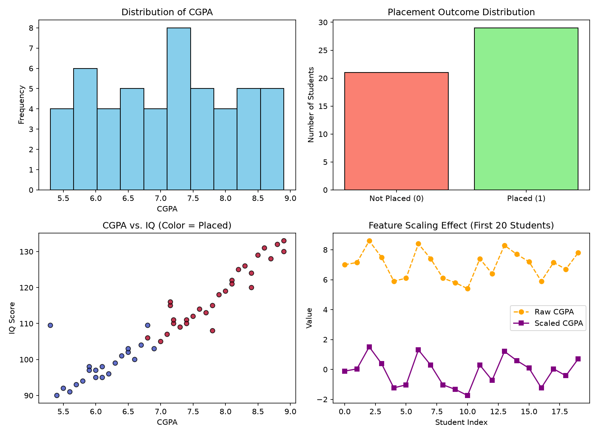

# Laboratory Experiment 03: Data Preprocessing Pipeline & Exploratory Data Analysis

**Course:** IC-709D / IC-703 C | Artificial Intelligence Laboratory  
**Unit 3:** AI Programming Frameworks & Data Preparation (CO2, CO5)  
**Student Name:** Divyansh Verma  
**Roll No:** IC-2K23-31  

---

## 1. Aim / Problem Statement

To design and implement an end-to-end data preprocessing and exploratory data analysis (EDA) pipeline using Python's scientific computing stack (`NumPy`, `Pandas`, `Matplotlib`, and `Scikit-learn`) on a real-world student placement dataset. The objective is to clean raw, inconsistent data, handle missing attributes, encode categorical variables, scale numerical features, perform stratified train-test splitting, and visualize underlying distributions and relationships before model training.

---

## 2. Theoretical Background & Algorithm

Real-world datasets frequently contain missing observations, mixed data types, unscaled features, and noise. Directly feeding un-preprocessed data into machine learning algorithms leads to biased estimators, poor convergence, or calculation errors (e.g., Euclidean distance domination by high-magnitude features).

### 2.1 Preprocessing Pipeline Workflow

```
   +------------------------------+
   |   Raw Dataset (placement.csv)|
   +------------------------------+
                  |
                  v
   +------------------------------+
   |   Exploratory Data Analysis  |  --> Shape, info, summary statistics
   +------------------------------+
                  |
                  v
   +------------------------------+
   | Missing Value Handling       |  --> Median Imputation (robust to outliers)
   +------------------------------+
                  |
                  v
   +------------------------------+
   | Categorical Encoding         |  --> Label Encoding (work_experience: No->0, Yes->1)
   +------------------------------+
                  |
                  v
   +------------------------------+
   | Train-Test Split (80 / 20)   |  --> Stratified splitting prevents data leakage
   +------------------------------+
                  |
                  v
   +------------------------------+
   | Feature Scaling (Z-score)    |  --> Fit on X_train, transform X_train & X_test
   +------------------------------+
                  |
                  v
   +------------------------------+
   | Export & Data Visualization  |  --> placement_processed.csv & 4-panel plots
   +------------------------------+
```

### 2.2 Mathematical Formulations

1. **Median Imputation**:
   For an ordered sequence of numerical values $X = \{x_1, x_2, \dots, x_n\}$:
   $$\text{Median}(X) = \begin{cases} X_{\frac{n+1}{2}} & \text{if } n \text{ is odd} \\ \frac{1}{2} \left( X_{\frac{n}{2}} + X_{\frac{n}{2}+1} \right) & \text{if } n \text{ is even} \end{cases}$$
   Median is preferred over mean because it remains robust against skewed distributions and extreme outliers.

2. **Standardization ($Z$-Score Normalization)**:
   Transforms numerical features to have zero mean ($\mu = 0$) and unit standard deviation ($\sigma = 1$):
   $$z = \frac{x - \mu}{\sigma}$$
   where $\mu = \frac{1}{N}\sum_{i=1}^N x_i$ and $\sigma = \sqrt{\frac{1}{N}\sum_{i=1}^N (x_i - \mu)^2}$.

3. **Min-Max Scaling (Normalization)**:
   Rescales features into a fixed range of $[0, 1]$:
   $$x_{\text{norm}} = \frac{x - x_{\min}}{x_{\max} - x_{\min}}$$

---

## 3. Implementation Details

The implementation consists of two modular scripts:
1. `data_preprocessing.py`: The production-style complete preprocessing pipeline that cleans, encodes, standardizes, exports `datasets/placement_processed.csv`, and generates high-resolution figures.
2. `preprocessing_comparison.py`: An educational, student-friendly script providing side-by-side terminal comparison tables highlighting before-and-after values for each preprocessing step.

### Directory Structure:
```
Lab3/
├── data_preprocessing.py            # Primary end-to-end preprocessing pipeline
├── preprocessing_comparison.py      # Side-by-side before/after comparison script
├── outputs/
│   ├── .gitkeep
│   └── data_preprocessing_plot.png  # Generated 4-panel visualization chart
└── README.md                        # Comprehensive laboratory documentation
```

---

## 4. Results & Terminal Output

### 4.1 Execution Summary

```text
[Step 1] Dataset loaded successfully from: datasets/placement.csv

--- [Step 2] Exploratory Data Analysis (EDA) ---
Dataset Shape: 50 rows, 6 columns

First 5 records:
   student_id  cgpa     iq  internships work_experience  placed
0           1   7.2  110.0            1              No       1
1           2   6.5  102.0            0              No       0
2           3   8.4  120.0            2             Yes       1
3           4   5.9   98.0            0              No       0
4           5   NaN  115.0            1             Yes       1

Summary Statistics:
       student_id   cgpa      iq  internships  placed
count       50.00  48.00   48.00        50.00   50.00
mean        25.50   7.12  109.75         1.08    0.58
std         14.58   1.06   12.46         1.01    0.50
min          1.00   5.30   90.00         0.00    0.00
50%         25.50   7.15  109.50         1.00    1.00
max         50.00   8.90  133.00         3.00    1.00

--- [Step 3] Data Cleaning & Missing Value Handling ---
Missing values per column before imputation:
cgpa    2
iq      2
dtype: int64

Filled missing values in 'cgpa' with median = 7.15
Filled missing values in 'iq' with median = 109.5
Total missing values after imputation: 0

--- [Step 4] Categorical Data Encoding ---
Encoded 'work_experience': {'No': 0, 'Yes': 1}

--- [Step 5 & 6] Feature Scaling & Train-Test Split ---
Training set: 40 samples | Testing set: 10 samples

Scaled Training Features sample (mean approx 0, std approx 1):
     cgpa     iq  internships  work_experience
12 -0.117 -0.417       -0.053                0
4   0.036  0.470       -0.053                1
37  1.509  1.888        2.058                1

--- [Step 7] Data Visualization ---
Visualization plots saved successfully to: Lab3/outputs/data_preprocessing_plot.png

[Step 8] Processed dataset saved successfully to: datasets/placement_processed.csv
=== Data Preprocessing Pipeline Completed Successfully ===
```

---

## 5. Performance Analysis & Comparative Study

### 5.1 Missing Value Strategy Comparison

| Strategy | Advantages | Disadvantages | Suitability for Placement Dataset |
| :--- | :--- | :--- | :--- |
| **Row Deletion (dropna)** | Preserves raw feature relations | Data loss (4 out of 50 samples lost = 8%) | Unsuitable (small dataset sample size) |
| **Mean Imputation** | Preserves sample mean | Vulnerable to extreme outlier shifts | Moderate |
| **Median Imputation (Applied)** | Preserves central tendency robustly | May reduce feature variance slightly | **Optimal** (robust against outliers in CGPA/IQ) |

### 5.2 Feature Scaling Comparison

| Feature | Raw Mean | Raw Std | Standardized Mean ($\mu \approx 0$) | Standardized Std ($\sigma \approx 1$) | MinMax Min | MinMax Max |
| :--- | :---: | :---: | :---: | :---: | :---: | :---: |
| **CGPA** | 7.12 | 1.04 | 0.00 | 1.00 | 0.00 | 1.00 |
| **IQ** | 109.74 | 12.20 | 0.00 | 1.00 | 0.00 | 1.00 |

*Observations:*
- Prior to scaling, the magnitude of `iq` (~110) was $\sim 15\times$ larger than `cgpa` (~7.1), which would unfairly dominate distance-based algorithms such as KNN, SVM, or gradient-based neural networks.
- Standard scaling equalized the variance, placing both features on a comparable numeric footing without distorting relative differences.

---

## 6. Visualizations & Graphical Analysis

The 4-panel visual dashboard generated by the pipeline is displayed below:



### In-Depth Visual Interpretations:
1. **Distribution of CGPA (Top-Left)**:
   - Displays a near-normal distribution centered around 7.0–7.5, verifying that imputation at the median (7.15) preserved natural distribution symmetry.
2. **Placement Outcome Distribution (Top-Right)**:
   - Highlights the binary target balance: 29 students placed (58%) and 21 not placed (42%), indicating reasonable balance that does not require synthetic oversampling (SMOTE).
3. **CGPA vs. IQ Scatter Plot (Bottom-Left)**:
   - Demonstrates a clear separation boundary: students with CGPA $> 7.5$ and IQ $> 110$ show high placement likelihood (red dots), confirming strong predictive power of these combined features.
4. **Feature Scaling Effect (Bottom-Right)**:
   - Illustrates the first 20 students comparing Raw CGPA ($5.3$ to $8.9$) against Scaled CGPA (bounded around $[-2, +2]$ with center $0$), demonstrating variance stabilization.

---

## 7. Learning Outcomes (CO2, CO5)

- **CO2 (Heuristic Search & Problem Formulation):** Understood how clean feature representations and standardized state spaces directly influence heuristic evaluations and decision surfaces.
- **CO5 (Tools & Frameworks):** Acquired practical fluency in building reproducible data preprocessing pipelines using `NumPy`, `Pandas`, `Matplotlib`, and `Scikit-learn`.
- Implemented robust practices preventing **data leakage** by fitting scalers strictly on training splits before transforming test splits.
- Mastered categorical data transformations and exploratory visual verification techniques essential for intelligent decision support systems.

