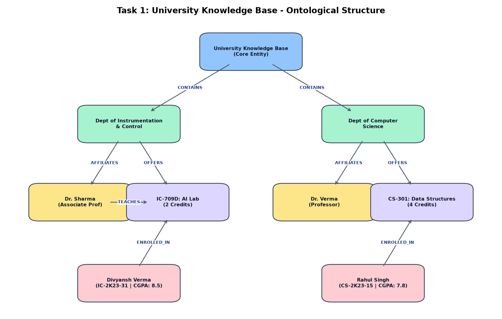
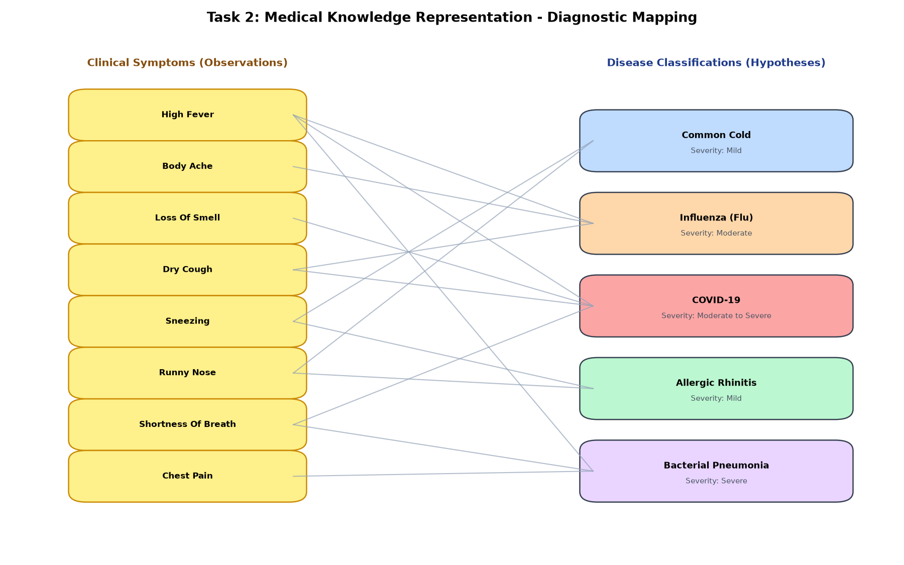
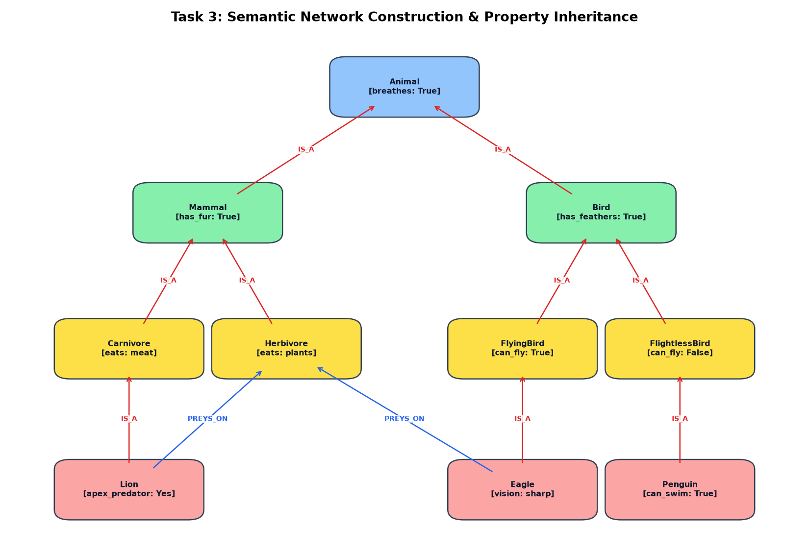
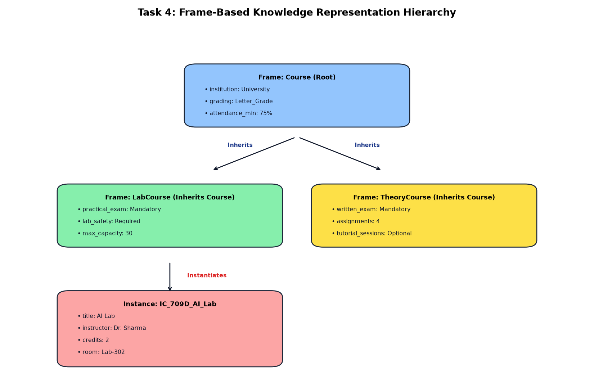
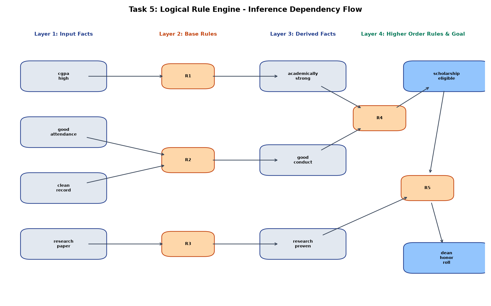

# Laboratory Experiment 04: Knowledge Representation & Logical Reasoning

**Course:** IC-709D / IC-703 C | Artificial Intelligence Laboratory  
**Unit 4:** Knowledge Representation & Logical Reasoning (CO1, CO3)  
**Student Name:** Divyansh Verma  
**Roll No:** IC-2K23-31  

---

## 1. Aim / Problem Statement

To implement and evaluate the core laboratory components for **Unit 4: Knowledge Representation & Logical Reasoning**:
1. **University Knowledge Base (`university_knowledgebase.py`)**: Model academic entities, course prerequisites, and eligibility evaluation inference rules.
2. **Medical Knowledge Representation (`medical_knowledgerepresentation.py`)**: Implement an intelligent clinical diagnostic knowledge base calculating differential diagnostic confidence scores from observed symptoms.
3. **Semantic Network Construction (`semantic_network.py`)**: Construct associative graph taxonomies with hierarchical `IS_A` inheritance property traversal.
4. **Frame Representation (`frames.py`)**: Implement object-centered frame structures with slots, facets, default values, and parent class delegation.
5. **Logical Rule Engine (`rule_engine.py`)**: Build production systems with Forward Chaining (data-driven) and Backward Chaining (goal-driven) inference engines.

---

## 2. Directory Structure

```
Lab4/
├── university_knowledgebase.py          # University Knowledge Base & Enrollment Engine
├── medical_knowledgerepresentation.py   # Clinical Diagnostic Knowledge Base
├── semantic_network.py                  # Semantic Network & Inheritance Reasoning
├── frames.py                            # Frame-Based Knowledge Representation
├── rule_engine.py                       # Dual-Direction Rule Engine (Forward & Backward)
├── outputs/
│   ├── university_knowledgebase.png     # University KB Ontological Diagram
│   ├── medical_knowledgerepresentation.png # Symptom-to-Disease Bipartite Diagnostic Map
│   ├── semantic_network.png             # Semantic Network Graph
│   ├── frames.png                       # Frame Hierarchy & Slot Resolution Layout
│   └── rule_engine.png                  # Rule Execution & Dependency Flow Graph
└── README.md                            # Comprehensive Laboratory Documentation
```

---

## 3. Algorithms & Theoretical Background

### 3.1 University Knowledge Base
- **Entities & Schema:** Formulates entities into computable relational tables: $\text{Departments}$, $\text{Faculty}$, $\text{Courses}$, and $\text{Students}$.
- **Inference Rule:**
  $$\text{Eligible}(s, c) \iff \Big( \text{Prerequisites}(c) \subseteq \text{CompletedCourses}(s) \Big) \land \big( \text{CGPA}(s) \ge 6.0 \big)$$

### 3.2 Medical Knowledge Representation
- **Diagnostic Heuristic:** Measures symptom overlap using set intersection:
  $$\text{Confidence}(D, S_{\text{patient}}) = \frac{|S_{\text{patient}} \cap S_{\text{disease}}|}{|S_{\text{disease}}|} \times 100\%$$
- Differential diagnostic ranking sorts prospective disease hypotheses in descending order of confidence score.

### 3.3 Semantic Network Construction
- **Graph Topology:** Directed graph $G = (V, E)$ where nodes represent conceptual categories and arcs represent semantic relations (`IS_A`, `PREYS_ON`).
- **Inheritance Traversal:** Queries climb up `IS_A` links recursively until the requested attribute is found or the root concept is reached.

### 3.4 Frame-Based Representation
- **Minsky Frame Architecture:** Object-centered schema $\langle \text{Name}, \text{Parent}, \text{Slots}, \text{Facets} \rangle$.
- **Lookup Resolution Order:**
  $$\text{Value}(S) = \text{LocalSlot}(S) \longrightarrow \text{DefaultFacet}(S) \longrightarrow \text{InheritedSlot}_{\text{Parent}}(S)$$

### 3.5 Logical Rule Engine
- **Forward Chaining (Data-Driven):** Starts with known working memory facts $W$. Iteratively evaluates rule antecedents:
  $$\text{IF } \text{Antecedents}(R_i) \subseteq W \implies W \leftarrow W \cup \{\text{Consequent}(R_i)\}$$
- **Backward Chaining (Goal-Driven):** Formulates the goal as a hypothesis and recursively verifies that candidate rule antecedents are satisfied by facts or sub-hypotheses.

---

## 4. Execution Results & Terminal Outputs

### 4.1 University Knowledge Base (`university_knowledgebase.py`)
```text
Evaluating Enrollment Queries:
  * Student: Divyansh Verma (S31) -> Course: Artificial Intelligence Lab (IC709D)
    Status : [ELIGIBLE] Reason: Eligible for enrollment.

  * Student: Divyansh Verma (S31) -> Course: Advanced Robotics (IC710)
    Status : [INELIGIBLE] Reason: Missing prerequisites: ['IC709D']

  * Student: Aman Kumar (S45) -> Course: Artificial Intelligence Lab (IC709D)
    Status : [INELIGIBLE] Reason: CGPA 5.8 is below minimum threshold (6.0).

  * Student: Rohan Mehta (S12) -> Course: Artificial Intelligence Lab (IC709D)
    Status : [INELIGIBLE] Reason: Missing prerequisites: ['CS101']
```

### 4.2 Medical Knowledge Representation (`medical_knowledgerepresentation.py`)
```text
Case Study: Patient P-102
Reported Symptoms: high fever, loss of smell, dry cough, fatigue

Differential Diagnostic Rankings:
Disease                  | Confidence   | Severity         | Matched Symptoms
---------------------------------------------------------------------------
COVID-19                 |     80.0 %  | Moderate to Severe | loss_of_smell, dry_cough, high_fever, fatigue
Influenza (Flu)          |     60.0 %  | Moderate         | fatigue, dry_cough, high_fever
Bacterial Pneumonia      |     20.0 %  | Severe           | high_fever
Common Cold              |      0.0 %  | Mild             | None
Allergic Rhinitis        |      0.0 %  | Mild             | None

Primary Diagnosis: [COVID-19] (Confidence: 80.0%)
Recommended Treatment Protocol: Isolation, pulse oximetry monitoring, consult physician.
```

### 4.3 Semantic Network Construction (`semantic_network.py`)
```text
Demonstrating Hierarchical Property Inheritance:
  * Query 'breathes' on [Lion]: True (Inherited from: [Animal])
  * Query 'has_fur' on [Lion]: True (Inherited from: [Mammal])
  * Query 'sound' on [Lion]: Roar (Inherited from: [Lion])
  * Query 'breathes' on [Eagle]: True (Inherited from: [Animal])
  * Query 'can_fly' on [Eagle]: True (Inherited from: [FlyingBird])
  * Query 'can_fly' on [Penguin]: False (Inherited from: [FlightlessBird])
  * Query 'can_swim' on [Penguin]: True (Inherited from: [Penguin])
  * Query 'has_feathers' on [Penguin]: True (Inherited from: [Bird])
```

### 4.4 Frame Representation (`frames.py`)
```text
Instantiated Frame: [IC_709D_AI_Lab] inheriting from [LabCourse] -> [Course]

Slot Resolution Trace:
  * Slot [title           ] = Artificial Intelligence Laboratory (Source: IC_709D_AI_Lab)
  * Slot [instructor      ] = Dr. Sharma                       (Source: IC_709D_AI_Lab)
  * Slot [practical_exam  ] = Mandatory                        (Source: LabCourse)
  * Slot [lab_safety      ] = Required                         (Source: LabCourse)
  * Slot [grading_mode    ] = Letter_Grade                     (Source: Course)
  * Slot [institution     ] = Engineering Institute            (Source: Course)
```

### 4.5 Logical Rule Engine (`rule_engine.py`)
```text
Initial Working Memory Facts: ['cgpa_high', 'good_attendance', 'clean_record', 'research_paper']

--- Forward Chaining Trace ---
  Cycle 1: Fired [R1] -> Added fact 'academically_strong'
  Cycle 1: Fired [R2] -> Added fact 'good_conduct'
  Cycle 1: Fired [R3] -> Added fact 'research_proven'
  Cycle 1: Fired [R4] -> Added fact 'scholarship_eligible'
  Cycle 1: Fired [R5] -> Added fact 'dean_honor_roll'
Total deduced facts: 9 (Rules fired: 5)

--- Backward Chaining Query: Can we prove 'dean_honor_roll'? ---
? Evaluating Goal: 'dean_honor_roll'
Trying [R5]: Antecedents {'scholarship_eligible', 'research_proven'}
  ... [Subgoals Verified Successfully] ...
-> [R5] SUCCEEDED! Verified 'dean_honor_roll'

Goal 'dean_honor_roll' Proven: True
```

---

## 5. Performance Analysis & Comparative Study

| Evaluation Criteria | Semantic Networks | Frames | Rule-Based Systems |
| :--- | :--- | :--- | :--- |
| **Primary Data Structure** | Directed Graph (Nodes & Edges) | Nested Record Objects (Slots & Facets) | Production Rules (IF-THEN) |
| **Knowledge Type** | Associative / Structural Taxonomy | Stereotypical / Object-Oriented | Procedural / Heuristic Reasoning |
| **Reasoning Method** | Graph Traversal & Inheritance | Slot Delegation & Default Resolution | Forward / Backward Inference Chaining |
| **Handling Exceptions** | Prone to link ambiguities | Handled via slot-override facets | Explicit negation rules required |
| **Modularity & Scaling** | Moderate (cycles can complicate search) | High (structured hierarchical packages) | Very High (independent rules modularly added) |
| **Best Application** | Concept Ontologies & Taxonomies | Entity State Modeling & Catalogues | Medical Diagnostics & Expert Advisories |

---

## 6. Generated Visualizations

### University Knowledge Base Structure


### Medical Diagnostic Mapping


### Semantic Network Construction


### Frame Representation Hierarchy


### Logical Rule Engine Dependency Flow


---

## 7. Learning Outcomes (CO1, CO3)

- **CO1 (AI Problem Formulation & Intelligent Problem Solving):** Modeled domain knowledge across academic, medical, and taxonomic environments into computable representations.
- **CO3 (Knowledge Representation & Logical Reasoning):**
  - Implemented graph-based semantic networks with multi-level property inheritance.
  - Implemented frame-based knowledge systems with default facets and behavioral attachments.
  - Constructed production rule inference engines implementing both forward and backward chaining search algorithms.
  - Formulated comparative criteria evaluating expressiveness, modularity, and inferential efficiency.
