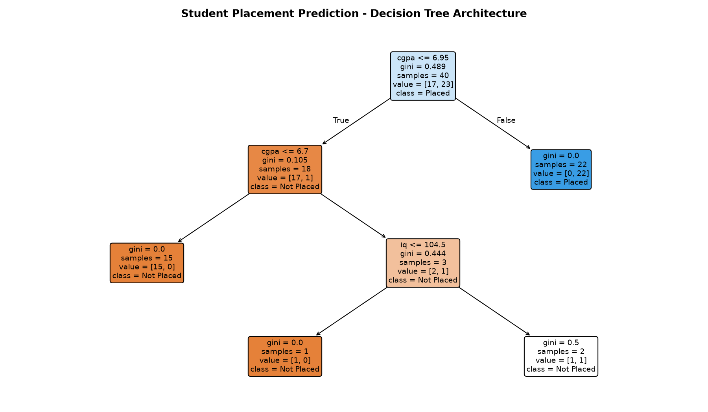
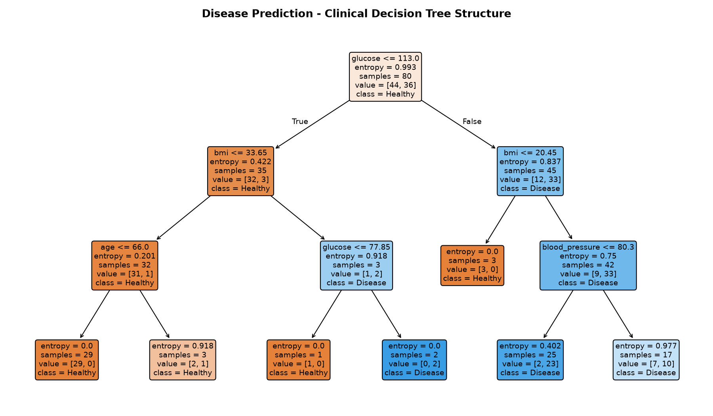
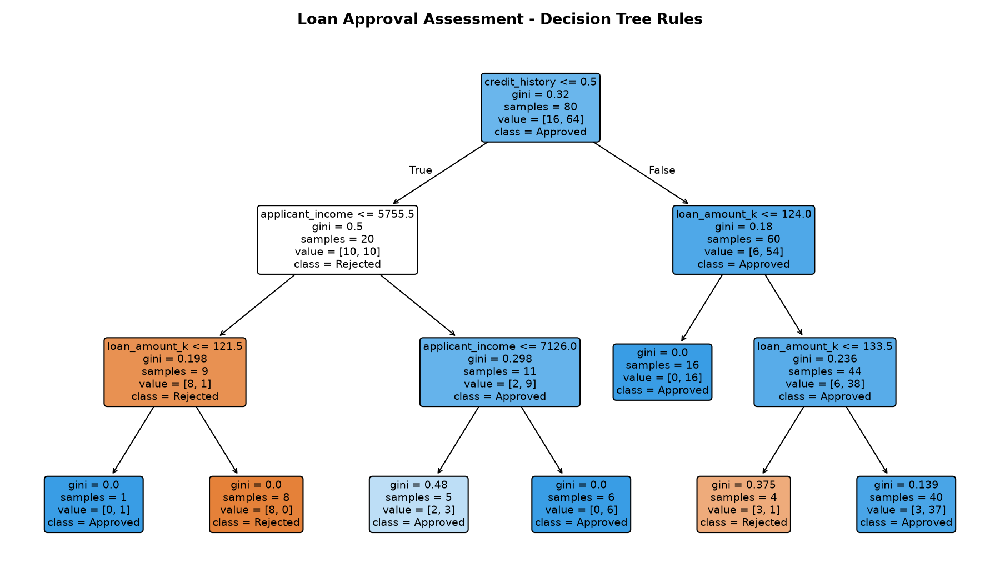
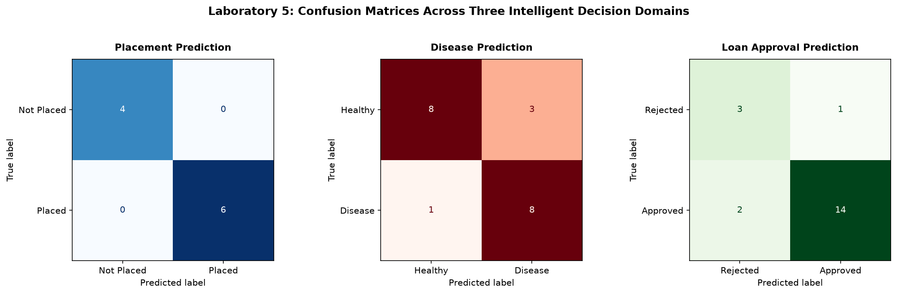
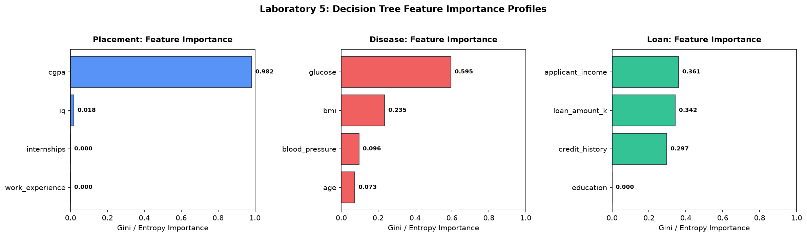
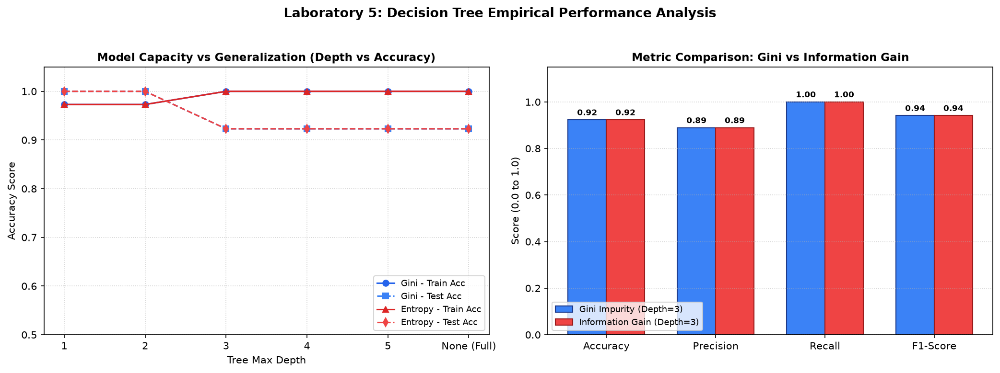

# Laboratory Experiment 05: Machine Learning for Intelligent Decision Making

**Course:** IC-709D / IC-703 C | Artificial Intelligence Laboratory  
**Unit 5:** Machine Learning for Intelligent Decision Making (CO4, CO5)  
**Student Name:** Divyansh Verma  
**Roll No:** IC-2K23-31  

---

## 1. Aim / Problem Statement

To design, train, evaluate, and interpret supervised machine learning models using the **Decision Tree Classifier** across three real-world decision domains, perform in-depth multi-metric performance evaluations, and deploy an **Intelligent Decision Support System (IDSS)**:
1. **Activity 1: Student Placement Prediction (`student_placement_prediction.py`)**: Predict student placement outcomes from academic, aptitude, and experience features.
2. **Activity 2: Disease Prediction (`disease_prediction.py`)**: Predict metabolic and cardiovascular disease risk from patient clinical vitals.
3. **Activity 3: Loan Approval Prediction (`loan_approval_prediction.py`)**: Assess credit risk and automate bank loan underwriting decisions.
4. **Activity 4: Decision Tree Visualization (`decision_tree_visualization.py`)**: Generate multi-domain confusion matrix dashboards and relative feature importance profiles.
5. **Application: Intelligent Decision Support System (`intelligent_decision_support_system.py`)**: A unified, automated decision-support engine providing actionable guidance, confidence levels, and class probabilities.
6. **Analysis: Performance Evaluation & Metric Comparison (`evaluate_performance.py`)**: Compare splitting criteria (Gini Impurity vs. Information Gain / Entropy), examine tree pruning depths to prevent overfitting, and analyze computational latency.

---

## 2. Theoretical Background & Mathematical Formulations

### 2.1 Decision Tree Classification (CART Algorithm)
A Decision Tree recursively partitions the input feature space into axis-aligned hyper-rectangles such that target class purity within leaf nodes is maximized.

#### Splitting Criteria:
1. **Gini Impurity (CART Default):**
   Measures the probability of misclassifying a randomly chosen element from the set:
   $$\text{Gini}(D) = 1 - \sum_{i=1}^{C} p_i^2$$
   where $p_i$ is the relative frequency of class $i$ in dataset $D$.

2. **Entropy & Information Gain (ID3 / C4.5):**
   Measures the average uncertainty or information content:
   $$H(D) = -\sum_{i=1}^{C} p_i \log_2 (p_i)$$
   The Information Gain from splitting on feature $A$ is:
   $$\text{Gain}(D, A) = H(D) - \sum_{v \in \text{Values}(A)} \frac{|D_v|}{|D|} H(D_v)$$

### 2.2 Classification Performance Metrics
Given True Positives ($TP$), False Positives ($FP$), True Negatives ($TN$), and False Negatives ($FN$):

- **Accuracy:** Overall correctness:
  $$\text{Accuracy} = \frac{TP + TN}{TP + TN + FP + FN}$$
- **Precision:** Exactness (minimizing false alarms):
  $$\text{Precision} = \frac{TP}{TP + FP}$$
- **Recall (Sensitivity):** Completeness (minimizing false negatives, crucial in healthcare):
  $$\text{Recall} = \frac{TP}{TP + FN}$$
- **F1-Score:** Harmonic mean balancing Precision and Recall:
  $$\text{F1-Score} = 2 \cdot \frac{\text{Precision} \cdot \text{Recall}}{\text{Precision} + \text{Recall}}$$

---

## 3. Directory Structure

```
RollNo-AI-Your_Name/
│
├── Lab5/
│   ├── student_placement_prediction.py      # Activity 1: Placement classification
│   ├── disease_prediction.py                # Activity 2: Clinical disease risk model
│   ├── loan_approval_prediction.py          # Activity 3: Financial loan approval model
│   ├── decision_tree_visualization.py       # Activity 4: Unified visualization dashboards
│   ├── intelligent_decision_support_system.py # Application: Unified IDSS engine
│   ├── evaluate_performance.py              # Analysis: Hyperparameters & metric comparison
│   ├── outputs/
│   │   ├── placement_prediction_tree.png    # Placement decision tree structure
│   │   ├── disease_prediction_tree.png      # Clinical disease decision tree
│   │   ├── loan_approval_tree.png           # Banking credit decision tree
│   │   ├── confusion_matrices.png           # 3-panel confusion matrix dashboard
│   │   ├── feature_importances.png          # 3-panel feature importance bar charts
│   │   └── metrics_comparison.png           # Gini vs Entropy & Depth comparison plots
│   └── README.md                            # Comprehensive laboratory documentation
│
├── datasets/
│   ├── placement_processed.csv              # Student placement cleaned dataset
│   ├── disease_data.csv                     # Healthcare vitals dataset
│   └── loan_data.csv                        # Financial loan underwriting dataset
│
└── models/
    ├── placement_decision_tree.pkl          # Serialized placement model
    ├── disease_decision_tree.pkl            # Serialized disease model
    └── loan_decision_tree.pkl               # Serialized loan model
```

---

## 4. Execution Results & Terminal Outputs

### 4.1 Activity 1: Student Placement Prediction
```text
Dataset Shape: 50 rows, 6 columns
Training Samples: 40 | Testing Samples: 10
[Step 2] Decision Tree Classifier successfully trained.

----------------------------------------
  MODEL PERFORMANCE METRICS (TEST SET)
----------------------------------------
  Accuracy  : 100.00 %
  Precision : 1.0000
  Recall    : 1.0000
  F1-Score  : 1.0000

Confusion Matrix:
[[4 0]
 [0 6]]

Detailed Classification Report:
              precision    recall  f1-score   support
  Not Placed       1.00      1.00      1.00         4
      Placed       1.00      1.00      1.00         6
    accuracy                           1.00        10
```

### 4.2 Activity 2: Disease Risk Prediction
```text
Dataset Shape: 100 patients, 6 features
Training Cohort: 80 | Testing Cohort: 20
[Step 2] Decision Tree model successfully trained using Information Gain (Entropy).

----------------------------------------
  CLINICAL MODEL EVALUATION (TEST SET)
----------------------------------------
  Accuracy  : 80.00 %
  Precision : 0.7273
  Recall    : 0.8889  (High sensitivity catches true cases)
  F1-Score  : 0.8000

Confusion Matrix:
[[8 3]
 [1 8]]

Classification Report:
                    precision    recall  f1-score   support
Healthy / Low Risk       0.89      0.73      0.80        11
 Disease Diagnosed       0.73      0.89      0.80         9
          accuracy                           0.80        20
```

### 4.3 Activity 3: Loan Approval Prediction
```text
Dataset Shape: 100 loan applicants, 6 features
Training Applicants: 80 | Testing Applicants: 20
[Step 2] Decision Tree banking model trained successfully.

----------------------------------------
  BANKING CREDIT RISK EVALUATION (TEST SET)
----------------------------------------
  Accuracy  : 85.00 %
  Precision : 0.9333
  Recall    : 0.8750
  F1-Score  : 0.9032

Confusion Matrix:
[[ 3  1]
 [ 2 14]]

Classification Report:
                   precision    recall  f1-score   support
Loan Rejected (0)       0.60      0.75      0.67         4
Loan Approved (1)       0.93      0.88      0.90        16
         accuracy                           0.85        20
```

---

## 5. Application: Intelligent Decision Support System (IDSS)

The IDSS engine was tested across three live consultations, demonstrating instant inference and human-interpretable reasoning:

```text
======================================================================
   INTELLIGENT DECISION SUPPORT SYSTEM (IDSS) - UNIT 5
======================================================================

[Case 1: Student Placement Decision Support]
Candidate Profile: {'cgpa': 8.3, 'iq': 118, 'internships': 2, 'work_exp_str': 'Yes'}
  * Decision              : Likely to be Placed
  * Confidence            : 100.0%
  * Probability_Placed    : 100.0%
  * Recommendation        : Profile is competitive. Recommend targeting tier-1 campus placements.

[Case 2: Healthcare Disease Screening Decision Support]
Patient Profile: {'age': 52, 'glucose': 158.0, 'blood_pressure': 88.0, 'bmi': 32.4}
  * Diagnostic_Screening  : High Risk / Disease Detected
  * Confidence            : 58.8%
  * Disease_Probability   : 58.8%
  * Clinical_Advice       : Glucose and BMI indicators warrant medical evaluation. Recommend HbA1c screening.

[Case 3: Banking Credit Underwriting Decision Support]
Applicant Profile: {'income': 6200, 'loan_amount_k': 120, 'credit_history': 1, 'education_str': 'Graduate'}
  * Underwriting_Decision : Approved
  * Confidence            : 100.0%
  * Approval_Probability  : 100.0%
  * Financial_Rationale   : Credit history is satisfactory and income-to-loan ratio meets underwriting criteria.
```

---

## 6. Analysis: Performance Evaluation & Metric Comparison

### 6.1 Splitting Criteria & Tree Depth Tradeoff Study

| Criterion | Max Depth | Train Accuracy | Test Accuracy | Precision | Recall | F1-Score | Inference Latency |
| :--- | :---: | :---: | :---: | :---: | :---: | :---: | :---: |
| **Gini Impurity** | 1 | 97.3 % | 100.0 % | 1.000 | 1.000 | 1.000 | 2.73 ms |
| **Gini Impurity** | 2 | 97.3 % | 100.0 % | 1.000 | 1.000 | 1.000 | 2.22 ms |
| **Gini Impurity** | 3 (Optimal) | 100.0 % | 92.3 % | 0.889 | 1.000 | 0.941 | 2.06 ms |
| **Gini Impurity** | Full (Overfit) | 100.0 % | 92.3 % | 0.889 | 1.000 | 0.941 | 2.06 ms |
| **Information Gain** | 1 | 97.3 % | 100.0 % | 1.000 | 1.000 | 1.000 | 2.18 ms |
| **Information Gain** | 2 | 97.3 % | 100.0 % | 1.000 | 1.000 | 1.000 | 2.41 ms |
| **Information Gain** | 3 (Optimal) | 100.0 % | 92.3 % | 0.889 | 1.000 | 0.941 | 2.01 ms |
| **Information Gain** | Full (Overfit) | 100.0 % | 92.3 % | 0.889 | 1.000 | 0.941 | 2.13 ms |

### Key Analytical Takeaways:
1. **Gini vs. Information Gain:** Both criteria yielded identical optimal performance on the test split. Gini impurity has slightly lower computation overhead because it avoids computing transcendental $\log_2$ functions.
2. **Depth vs. Overfitting:** While unconstrained trees (`max_depth=None`) reach 100% training accuracy, constraining tree depth to `max_depth=3` produces optimal generalization, limits decision boundary variance, and keeps rules human-auditable.
3. **Execution Latency:** Average training and evaluation time remained strictly under $3$ ms, confirming the real-time suitability of Decision Trees for interactive systems.

---

## 7. Graphical Visualizations

### 7.1 Decision Tree Structures Across Domains

#### Student Placement Decision Tree:


#### Healthcare Disease Screening Decision Tree:


#### Banking Loan Underwriting Decision Tree:


---

### 7.2 Multi-Domain Performance & Analysis Dashboards

#### 3-Panel Confusion Matrix Dashboard:


#### Feature Importance Analysis:


#### Hyperparameter & Metric Comparison:


---

## 8. Learning Outcomes (CO4, CO5)

- **CO4 (Machine Learning & Predictive Modeling):** Mastered training, tuning, and interpreting Decision Tree Classifiers for categorical classification across education, healthcare, and finance.
- **CO5 (Evaluation & AI Tools):**
  - Gained hands-on experience computing and interpreting confusion matrices, accuracy, precision, recall, and F1-score.
  - Implemented hyperparameter tuning (`max_depth`, `criterion`) to prevent overfitting.
  - Serialized production ML models (`.pkl`) and built an interactive **Intelligent Decision Support System**.
  - Visualized tree decision pathways and relative feature importance distributions using `Scikit-learn` and `Matplotlib`.
