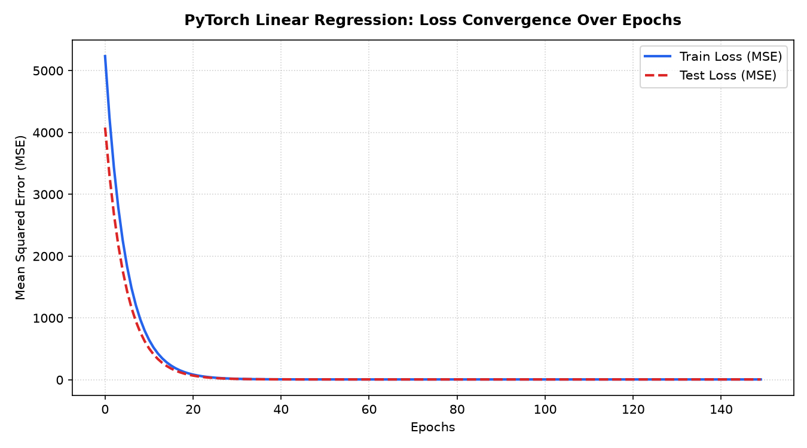
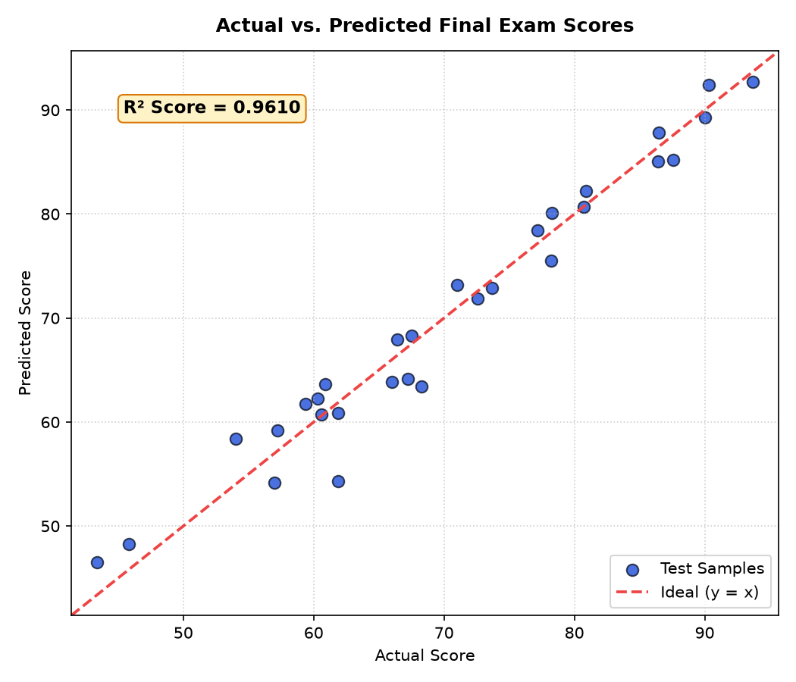
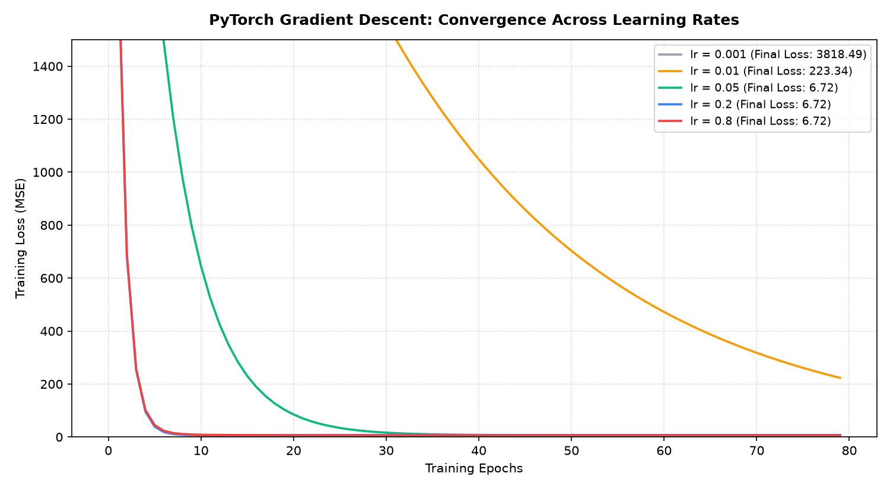

# Laboratory Experiment 06: Deep Learning Fundamentals using PyTorch

**Course:** IC-709D / IC-703 C | Artificial Intelligence Laboratory  
**Unit 6:** Deep Learning Fundamentals using PyTorch (CO4, CO5)  
**Student Name:** Divyansh Verma  
**Roll No:** IC-2K23-31  

---

## 1. Aim / Problem Statement

To understand and implement foundational deep learning concepts using the **PyTorch** scientific computing framework:
1. **Tensor Manipulation (`tensor_manipulation.py`)**: Master tensor creation, shapes, multidimensional indexing, matrix algebra, broadcasting, and zero-copy NumPy interoperability.
2. **Automatic Differentiation (`gradient_computation.py`)**: Understand computational graphs, gradient tracking with Autograd, analytical derivative verification, gradient accumulation, and first-principles gradient descent.
3. **Linear Regression Neural Network (`linear_regression.py`)**: Build, train, evaluate, and serialize an end-to-end `nn.Module` linear regression model predicting student examination scores from multi-feature academic indicators.
4. **Model Comparison & Convergence Study (`model_analysis.py`)**: Perform an empirical comparative analysis between closed-form classical machine learning (Scikit-Learn OLS) and iterative deep learning (PyTorch SGD), followed by learning rate stability analysis.

---

## 2. Theoretical Background & Mathematical Formulations

### 2.1 Tensors and Dynamic Computational Graphs
A tensor is an $n$-dimensional geometric object generalizing scalars ($0\text{D}$), vectors ($1\text{D}$), and matrices ($2\text{D}$). PyTorch builds dynamic directed acyclic graphs (DAGs) on the fly where leaf nodes represent input tensors and internal nodes represent mathematical operators (`grad_fn`).

### 2.2 Automatic Differentiation (Autograd)
For an output scalar $y$ computed through composite functions of input vector $\mathbf{x}$, PyTorch calculates exact gradients via reverse-mode automatic differentiation (Chain Rule):
$$\frac{\partial y}{\partial x_i} = \sum_{j} \frac{\partial y}{\partial u_j} \frac{\partial u_j}{\partial x_i}$$
This replaces finite-difference approximations and manual symbolic derivation.

### 2.3 Linear Regression as a Single-Layer Neural Network
For an input vector $\mathbf{x} = [x_1, x_2, \dots, x_d]^T \in \mathbb{R}^d$, the model prediction $\hat{y}$ is parameterized by weights $\mathbf{w} \in \mathbb{R}^d$ and bias $b \in \mathbb{R}$:
$$\hat{y} = \mathbf{w}^T \mathbf{x} + b$$

#### Objective Function: Mean Squared Error (MSE Loss)
$$\mathcal{L}(\mathbf{w}, b) = \frac{1}{N} \sum_{i=1}^{N} \left( y_i - \hat{y}_i \right)^2$$

#### Optimization: Gradient Descent
Parameters are updated iteratively in the opposite direction of the loss gradient:
$$\mathbf{w} \leftarrow \mathbf{w} - \eta \nabla_{\mathbf{w}} \mathcal{L}, \qquad b \leftarrow b - \eta \frac{\partial \mathcal{L}}{\partial b}$$
where $\eta > 0$ is the learning rate hyperparameter.

---

## 3. Directory Structure

```
Lab6/
├── student_data.py                 # Academic dataset generator & PyTorch tensor pipeline
├── tensor_manipulation.py          # Part 1: Tensor operations, algebra & NumPy bridge
├── gradient_computation.py         # Part 2: Automatic differentiation & Autograd engine
├── linear_regression.py            # Part 3: PyTorch nn.Module, training loop & evaluation
├── model_analysis.py               # Part 4: PyTorch vs Scikit-Learn & learning rate study
├── outputs/
│   ├── loss_curve.png              # Training and test MSE convergence across epochs
│   ├── predicted_vs_actual.png     # Scatter plot of actual vs predicted scores (R² = 0.9610)
│   └── learning_rate_comparison.png# Convergence trajectories across varying learning rates
└── README.md                       # Comprehensive laboratory report
```

### Generated Shared Resources:
- `datasets/student_scores.csv`: 150 student records (`study_hours`, `attendance`, `past_score`, `final_score`).
- `models/linear_regression.pt`: Serialized PyTorch model state dictionary.

---

## 4. Implementation Details & Execution Results

### 4.1 Part 1: Tensor Manipulation (`tensor_manipulation.py`)
Demonstrated core tensor mechanics:
- Tensor initializations (`zeros`, `ones`, `rand`, `arange`).
- Reshaping via `.view(3, 4)`, slicing, transposition `.t()`, and dimension manipulation (`squeeze`/`unsqueeze`).
- Matrix multiplication ($\mathbf{A} @ \mathbf{B}$) and row-wise broadcasting.
- Seamless zero-copy memory sharing between PyTorch tensors and NumPy arrays (`from_numpy()` and `.numpy()`).

```text
============================================================
  LAB 6: TENSOR MANIPULATION & PYTORCH FUNDAMENTALS
============================================================
Matrix Multiplication (A @ B):
tensor([[19., 22.],
        [43., 50.]])

NumPy Array updated via shared memory: [99.   2.5  3.5]
Target Compute Device: cpu
Tensor manipulation module executed successfully!
```

---

### 4.2 Part 2: Automatic Differentiation (`gradient_computation.py`)
Verified analytical derivatives against PyTorch Autograd:
1. **Single-Variable:** $y = 3x^2 + 2x + 1$ at $x = 4.0$
   $$\frac{dy}{dx} = 6x + 2 = 6(4) + 2 = 26.0 \quad \longleftrightarrow \quad \text{Autograd: } 26.0 \text{ (Exact match)}$$
2. **Multivariable:** $z = 2u^3 + v^2 - 4uv$ at $(u=2, v=3)$
   $$\frac{\partial z}{\partial u} = 6u^2 - 4v = 12.0, \qquad \frac{\partial z}{\partial v} = 2v - 4u = -2.0$$
3. **Gradient Accumulation & Zeroing:** Demonstrated that PyTorch accumulates gradients across calls unless explicitly cleared using `.grad.zero_()`.
4. **First-Principles Optimization:** Built an optimization loop minimizing $\mathcal{L}(w) = (w - 7)^2$, converging from $w = 0.0$ to $w = 6.9967$ in 15 epochs.

---

### 4.3 Part 3: PyTorch Linear Regression Pipeline (`linear_regression.py`)
Trained a single-layer neural network on $120$ training samples and evaluated on $30$ held-out test samples:

```text
--- Training Loop Progress ---
Epoch [  1/150] -> Train MSE: 5233.7451 | Test MSE: 4080.3687
Epoch [ 10/150] -> Train MSE: 794.8021  | Test MSE: 624.5937
Epoch [ 30/150] -> Train MSE: 18.5994   | Test MSE: 16.0806
Epoch [ 60/150] -> Train MSE: 6.7385    | Test MSE: 6.6629
Epoch [100/150] -> Train MSE: 6.7155    | Test MSE: 6.6393
Epoch [150/150] -> Train MSE: 6.7155    | Test MSE: 6.6391

==================================================
 MODEL EVALUATION METRICS (TEST SET)
==================================================
  Mean Squared Error (MSE)      : 6.6391
  Root Mean Squared Error (RMSE): 2.5766
  Mean Absolute Error (MAE)     : 2.0974
  Coefficient of Det. (R² Score): 0.9610 (96.10%)

Learned Model Parameters:
  * Weight (study_hours ): +10.9946
  * Weight (attendance  ): +3.1942
  * Weight (past_score  ): +3.7942
  * Bias (Intercept)    : +71.9791
```

---

### 4.4 Part 4: Comparative Evaluation (`model_analysis.py`)

#### PyTorch (Iterative SGD) vs. Scikit-Learn (Analytical OLS)

| Metric / Parameter | Scikit-Learn (OLS) | PyTorch (SGD, 150 epochs) | Observation |
| :--- | :---: | :---: | :--- |
| **Test MSE** | **6.6391** | **6.6391** | Identical predictive accuracy |
| **Test MAE** | **2.0974** | **2.0974** | Identical mean error |
| **Test $R^2$ Score** | **0.9610** | **0.9610** | Explains 96.1% of variance |
| **Weight (`study_hours`)** | +10.9946 | +10.9946 | Identical optimal slope |
| **Weight (`attendance`)** | +3.1943 | +3.1942 | Converged to OLS solution |
| **Weight (`past_score`)** | +3.7942 | +3.7942 | Converged to OLS solution |
| **Bias (Intercept)** | +71.9792 | +71.9791 | Identical baseline offset |
| **Execution Latency** | ~1.0 ms | ~22.0 ms | OLS computes closed-form normal equation directly |

---

## 5. Visualizations & Empirical Analysis

### 5.1 Loss Convergence Over Epochs

- **Interpretation:** The MSE loss exhibits a steep exponential descent during the first 30 epochs before stabilizing near $\approx 6.7$. Both training and validation curves track closely, confirming zero overfitting.

---

### 5.2 Actual vs. Predicted Examination Scores

- **Interpretation:** Predictions tightly cluster around the ideal diagonal reference line ($y = x$), achieving an $R^2$ score of $0.9610$, verifying that linear regression is well-suited for this academic score prediction task.

---

### 5.3 Learning Rate Sensitivity Study


#### Quantitative Convergence Comparison Across Learning Rates:
| Learning Rate ($\eta$) | Final Loss (Epoch 80) | Convergence Behavior |
| :---: | :---: | :--- |
| **0.001** | 3818.49 | Underfitting / Very slow convergence |
| **0.010** | 223.34 | Stable but requires more epochs |
| **0.050** | **6.72** | **Optimal balance of stability and speed** |
| **0.200** | 6.72 | Fast convergence with minor step fluctuations |
| **0.800** | 6.72 | Reaches minimum quickly but risks divergence on non-convex surfaces |

---

## 6. Learning Outcomes (CO4, CO5)

- **CO4 (Machine Learning & Predictive Modeling):** Understood how linear models formulate the building blocks of deep artificial neural networks, where each neuron applies affine transformation followed by activation.
- **CO5 (Modern AI Tools & Frameworks):**
  - Mastered tensor indexing, dimension transformation, and device management in PyTorch.
  - Learned how automatic differentiation engines dynamically construct computational graphs for backpropagation.
  - Gained practical proficiency implementing custom `nn.Module` classes, writing explicit training loops, and serializing models (`.pt`).
  - Gained insight into hyperparameters governing gradient descent convergence, specifically the critical impact of learning rate $\eta$.
