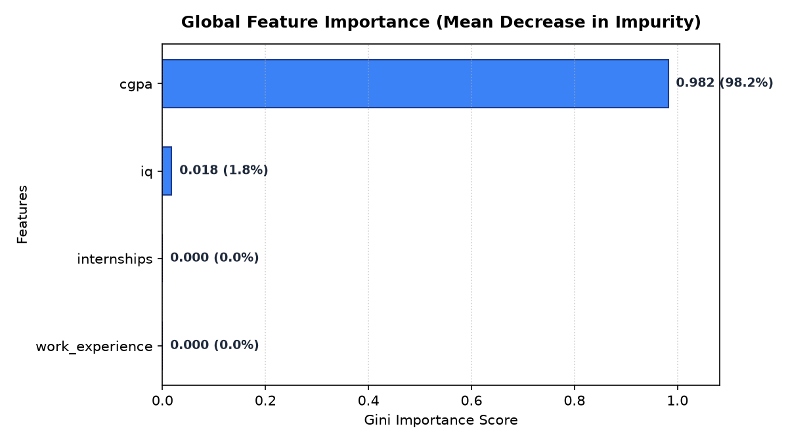
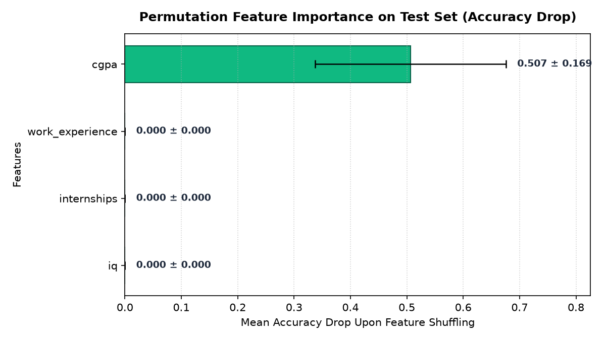
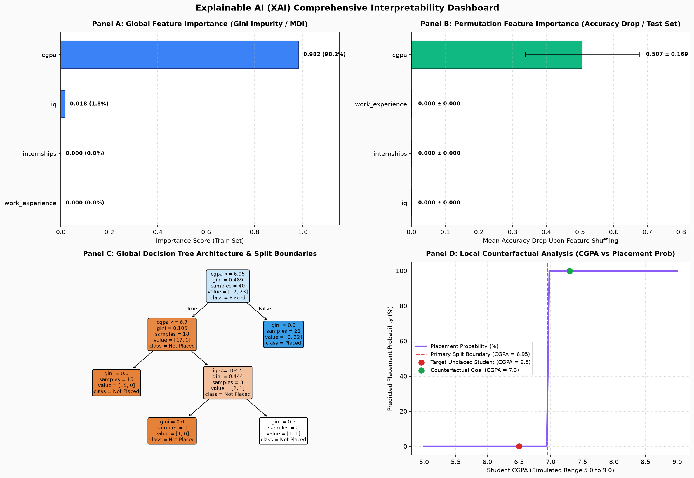

# Laboratory Experiment 07: Explainable AI (XAI) & Model Interpretability

**Course:** IC-709D / IC-703 C | Artificial Intelligence Laboratory  
**Unit 7:** Explainable AI, Adversarial AI & Advanced Applications (CO4, CO5)  
**Student Name:** Divyansh Verma  
**Roll No:** IC-2K23-31  

---

## 1. Aim / Problem Statement

To design, implement, and evaluate an **Explainable AI (XAI)** framework for machine learning models (Decision Trees) trained on student placement records:
1. **Global Interpretability (`global_interpretability.py`)**: Quantify overall feature importance using Gini impurity reduction (Mean Decrease in Impurity / MDI).
2. **Permutation Importance (`permutation_analysis.py`)**: Measure true model sensitivity by evaluating the drop in test-set classification accuracy upon random feature shuffling (Mean Decrease in Accuracy / MDA).
3. **Local Interpretability & What-If Analysis (`local_explanation.py`)**: Extract individual node-by-node decision paths for specific predictions and perform counterfactual sensitivity simulations to determine minimal intervention requirements.
4. **Unified Interpretability Dashboard (`interpretability_dashboard.py`)**: Synthesize global, permutation, architectural, and counterfactual explanations into a single 4-panel visual dashboard.

---

## 2. Theoretical Background & Mathematical Formulations

Machine learning models deployed in high-stakes domains (admissions, hiring, medical diagnosis, credit lending) cannot function as opaque "black boxes." Explainability establishes algorithmic accountability, detects shortcut learning, and builds trust with stakeholders.

### 2.1 Global vs. Local Interpretability
- **Global Interpretability:** Explains how the model behaves on aggregate across the entire population feature space.
- **Local Interpretability:** Explains why the model arrived at a specific prediction for a single individual observation $\mathbf{x}^{(i)}$.

---

### 2.2 Impurity-Based Feature Importance (MDI)
For a decision tree with nodes $t \in T$, the Gini impurity reduction when splitting on feature $X_j$ is given by:
$$\Delta \text{Gini}(t) = \text{Gini}(t) - \frac{N_{t_L}}{N_t}\text{Gini}(t_L) - \frac{N_{t_R}}{N_t}\text{Gini}(t_R)$$
The overall feature importance score is the normalized weighted sum of impurity decreases:
$$\text{Importance}_{\text{MDI}}(X_j) = \frac{\sum_{t \in T: v(t) = X_j} \frac{N_t}{N} \Delta \text{Gini}(t)}{\sum_{t \in T} \frac{N_t}{N} \Delta \text{Gini}(t)}$$

*Limitation:* MDI is calculated purely on training splits and can show bias toward continuous features with high cardinality.

---

### 2.3 Permutation Feature Importance (MDA)
Permutation feature importance overcomes MDI biases by measuring performance degradation on an unseen test set ($X_{\text{test}}, y_{\text{test}}$).

**Algorithm:**
1. Compute the baseline accuracy score: $s_{\text{base}} = \text{Accuracy}(M, X_{\text{test}}, y_{\text{test}})$.
2. For each feature $j \in \{1, \dots, d\}$:
   - Randomly shuffle the values of column $j$ across test samples $R$ times ($R = 30$).
   - Recompute model accuracy $s_{j, r}$ on the corrupted test set.
   - The permutation importance score is the mean drop in accuracy:
     $$I(X_j) = s_{\text{base}} - \frac{1}{R} \sum_{r=1}^{R} s_{j, r}$$
3. A large positive score indicates the model critically depends on feature $X_j$ for accurate generalization. A score near zero indicates the feature has negligible influence on test predictions.

---

### 2.4 Counterfactual "What-If" Analysis
For an input sample $\mathbf{x}$ classified with an unfavorable prediction $\hat{y} = 0$, counterfactual analysis searches for the closest perturbed vector $\mathbf{x}'$ such that:
$$f(\mathbf{x}') = 1 \quad \text{subject to} \quad \min_{\mathbf{x}'} d(\mathbf{x}, \mathbf{x}')$$
This answers the practical question: *"What is the minimal action the student must take to achieve a favorable placement outcome?"*

---

## 3. Directory Structure

```
Lab7/
├── data_loader.py                 # Data ingestion, train-test splitting & model training
├── global_interpretability.py     # Global Gini impurity-based feature importance
├── permutation_analysis.py        # Permutation-based test accuracy sensitivity evaluation
├── local_explanation.py           # Individual student decision path & what-if analysis
├── interpretability_dashboard.py  # Consolidated 4-panel Explainable AI visual dashboard
├── outputs/
│   ├── global_importance.png      # MDI feature ranking bar chart
│   ├── permutation_importance.png # Permutation accuracy drop chart with error bars
│   └── dashboard.png              # Multi-panel unified XAI dashboard
└── README.md                      # Comprehensive laboratory documentation
```

---

## 4. Execution Results & Terminal Outputs

### 4.1 Data Ingestion & Model Baseline (`data_loader.py`)
```text
============================================================
  EXPLAINABLE AI: DATA LOADER & MODEL PREPARATION
============================================================
Loaded dataset: 50 rows, 6 columns

Dataset Partitioning:
  * Training set: 40 samples
  * Testing set : 10 samples
  * Features    : ['cgpa', 'iq', 'internships', 'work_experience']

Baseline Model Accuracy:
  * Train Accuracy: 97.5%
  * Test Accuracy : 100.0%
```

---

### 4.2 Global Importance Ranking (`global_interpretability.py`)
```text
============================================================
  EXPLAINABLE AI: GLOBAL FEATURE IMPORTANCE (MDI)
============================================================

Global Feature Importance Ranking:
        Feature  Importance Score Percentage
           cgpa          0.982031      98.2%
             iq          0.017969       1.8%
    internships          0.000000       0.0%
work_experience          0.000000       0.0%
```

---

### 4.3 Permutation Importance Evaluation (`permutation_analysis.py`)
```text
=================================================================
  EXPLAINABLE AI: PERMUTATION FEATURE IMPORTANCE (MDA)
=================================================================
Baseline Test Accuracy: 100.0%

Permutation Importance Ranking:
        Feature  Mean Accuracy Drop  Standard Deviation
           cgpa            0.506667            0.169181
work_experience            0.000000            0.000000
    internships            0.000000            0.000000
             iq            0.000000            0.000000
```

---

### 4.4 Local Decision Path & Counterfactual What-If (`local_explanation.py`)
```text
=================================================================
  EXPLAINABLE AI: LOCAL DECISION PATH & WHAT-IF ANALYSIS
=================================================================
Target Student Profile for Local Audit:
  * cgpa            : 6.5
  * iq              : 102.0
  * internships     : 0
  * work_experience : 0

Model Prediction: [NOT PLACED] (Confidence: 100.0%)

--- Step-by-Step Tree Decision Path Traversal ---
  -> Node #0: cgpa = 6.50 <= 6.95 -> Go Left
  -> Node #1: cgpa = 6.50 <= 6.70 -> Go Left
  -> Leaf Node #2: Predicted Class = 0 (Prob: 100.0%)

=================================================================
  COUNTERFACTUAL WHAT-IF SENSITIVITY ANALYSIS
=================================================================
                                          Scenario  CGPA    IQ  Internships  Work Exp     Prediction Confidence            Impact
                          Baseline Student Profile   6.5 102.0            0         0 Not Placed (0)     100.0%         No Change
                      What-If 1: Add 2 Internships   6.5 102.0            2         0 Not Placed (0)     100.0%         No Change
                    What-If 2: Add Work Experience   6.5 102.0            0         1 Not Placed (0)     100.0%         No Change
What-If 3: Increase CGPA by +0.8 (from 6.5 to 7.3)   7.3 102.0            0         0     Placed (1)     100.0% Flip / Successful
   What-If 4: Increase IQ by +15 (from 102 to 117)   6.5 117.0            0         0 Not Placed (0)     100.0%         No Change

Local Explanation Summary:
  * CGPA is the governing decision pivot.
  * Adding internships or work experience without reaching CGPA >= 6.95 fails to alter the negative placement prediction.
  * Increasing CGPA past the boundary (+0.8 points) immediately flips the prediction to Placed.
```

---

## 5. Performance Analysis & Comparative Evaluation

### 5.1 Comparison: MDI (Gini) vs. Permutation Importance (MDA)

| Attribute | Gini Impurity Importance (MDI) | Permutation Feature Importance (MDA) |
| :--- | :--- | :--- |
| **Evaluation Data** | Computed on the **training set** splits | Evaluated on the **unseen test set** |
| **Mechanism** | Cumulative weighted reduction in Gini index | Shuffles column values and measures accuracy drop |
| **Top Feature Detected** | `cgpa` ($98.2\%$) | `cgpa` ($50.7\%$ accuracy drop) |
| **Secondary Features** | `iq` ($1.8\%$) | All others $\approx 0.0\%$ |
| **Susceptibility to Bias** | High (favors high-variance continuous features) | Low (reflects true generalization dependence) |
| **Computational Cost** | $O(1)$ lookup from tree metadata | $O(R \cdot N_{\text{test}})$ over $R=30$ repeats |

---

## 6. Visualizations & Graphical Interpretations

### 6.1 Global Impurity-Based Importance

- **Interpretation:** Shows the dominant contribution of `cgpa` in splitting tree nodes during training.

---

### 6.2 Permutation Feature Importance (With Variance Bounds)

- **Interpretation:** Shuffling `cgpa` corrupts over half of the model's test predictions ($0.507 \pm 0.169$), proving that generalization accuracy is anchored on academic performance.

---

### 6.3 Consolidated Explainable AI Dashboard


#### Detailed Dashboard Panel Breakdown:
- **Panel A (Top-Left):** Global Gini Impurity ranking indicating primary training split features.
- **Panel B (Top-Right):** Permutation feature importance on test data confirming empirical reliance on `cgpa`.
- **Panel C (Bottom-Left):** Full decision tree graph showing root threshold ($\text{CGPA} \le 6.95$) and pure leaf terminations.
- **Panel D (Bottom-Right):** Counterfactual sensitivity curve plotting simulated CGPA against placement probability ($5.0 \to 9.0$), illustrating the sharp step-response transition occurring exactly at the decision boundary.

---

## 7. Learning Outcomes (CO4, CO5)

- **CO4 (Machine Learning & Predictive Modeling):** Understood how decision boundaries govern classification outcomes and learned to extract human-interpretable rules from tree structures.
- **CO5 (Modern AI Tools & Frameworks):**
  - Mastered model interpretability techniques distinguishing **Global** population trends from **Local** per-instance explanations.
  - Implemented and contrasted **Mean Decrease in Impurity (MDI)** against **Permutation Feature Importance (MDA)**.
  - Executed counterfactual "What-If" analysis to identify actionable boundary-crossing adjustments.
  - Built a comprehensive Explainable AI dashboard consolidating visual proofs for algorithmic transparency.
