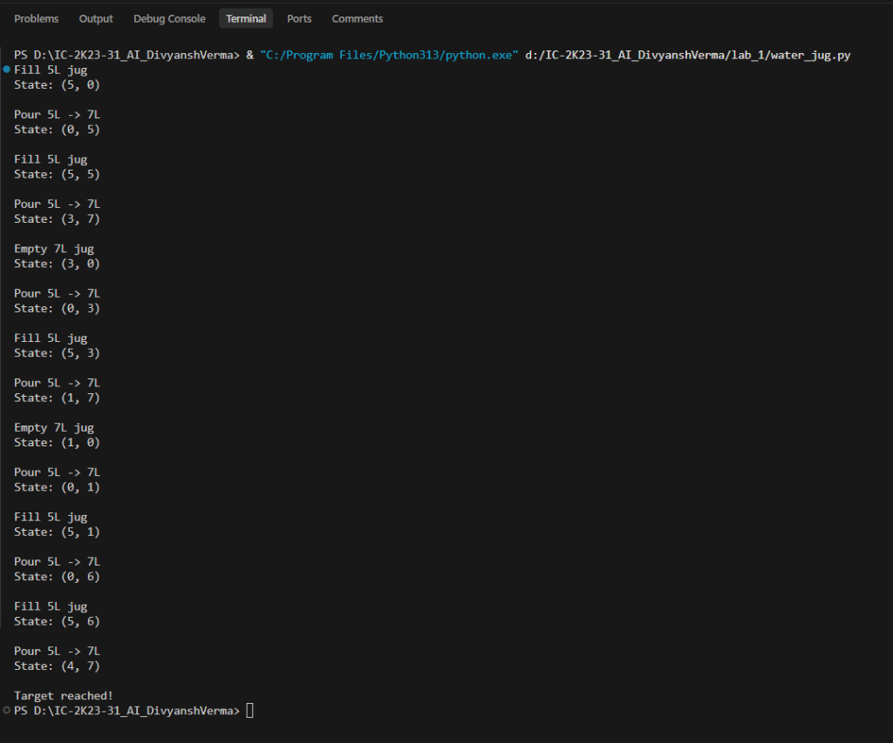
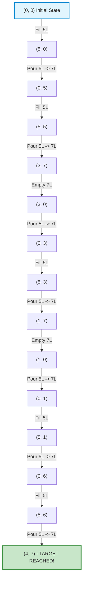
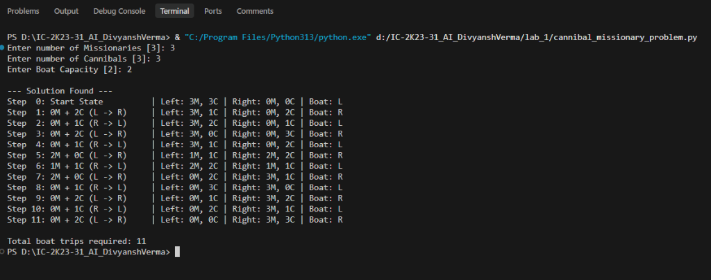
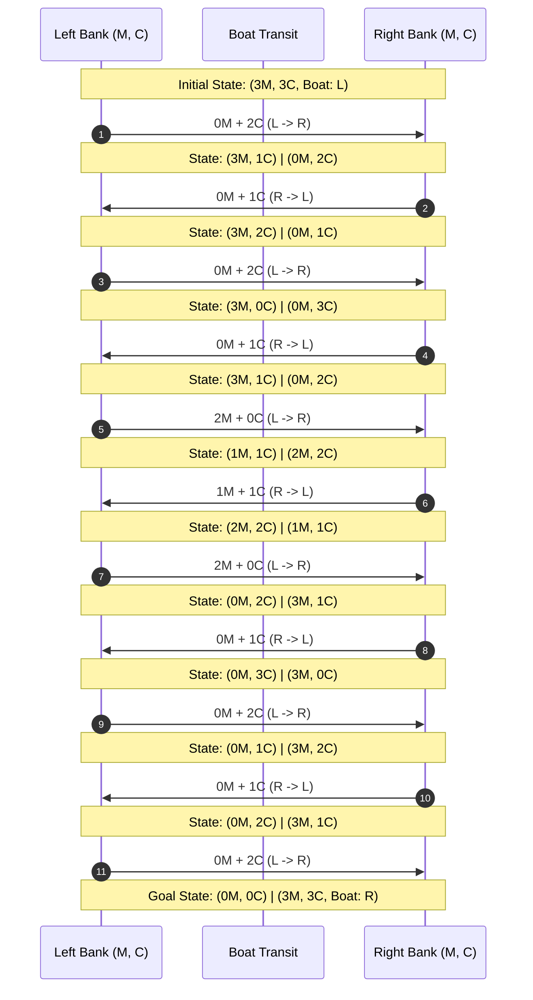
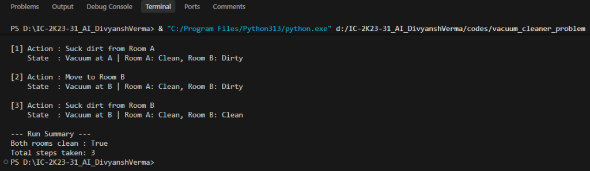
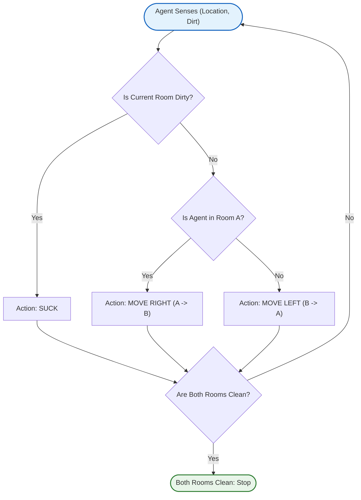
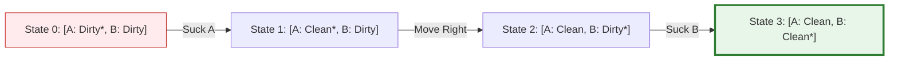

# Artificial Intelligence Lab – IC-2K23-31

<p align="center">
  <strong>Artificial Intelligence Practical Implementations</strong><br>
  Water Jug Problem · Missionaries and Cannibals · Vacuum Cleaner Problem
</p>

---

## Overview

This repository contains Python implementations of three classical Artificial Intelligence problems. Each practical demonstrates how an AI problem can be represented using states, actions, rules, and goal conditions.

The implementations explore three different problem-solving approaches:

1. **Water Jug Problem:** Deterministic state iteration to measure a target quantity of water using mathematical pour-transfer rules.
2. **Missionaries and Cannibals Problem:** Breadth-First Search (BFS) state-space exploration to find the shortest safe sequence of river crossings.
3. **Vacuum Cleaner Problem:** A Simple Reflex Agent that selects actions using condition-action production rules within a two-room environment.

---

## Table of Contents

- [1. Water Jug Problem](#1-water-jug-problem)
- [2. Missionaries and Cannibals Problem](#2-missionaries-and-cannibals-problem)
- [3. Vacuum Cleaner Problem](#3-vacuum-cleaner-problem)
- [4. Consolidated Performance Analysis](#4-consolidated-performance-analysis)
- [5. Screenshots and Visualizations](#5-screenshots-and-visualizations)
  - [5.1 Water Jug Problem](#51-water-jug-problem)
  - [5.2 Missionaries and Cannibals Problem](#52-missionaries-and-cannibals-problem)
  - [5.3 Vacuum Cleaner Problem](#53-vacuum-cleaner-problem)
  - [5.4 Graphs and State Space Visualizations](#54-graphs-and-state-space-visualizations)
- [6. Learning Outcomes](#6-learning-outcomes)
- [7. Requirements and Execution](#7-requirements-and-execution)

---

# 1. Water Jug Problem

## 1.1 Aim

To implement the Water Jug Problem in Python using an algorithmic approach and determine a sequence of operations that measures an exact target amount of water using two jugs of given capacities.

## Problem Statement

Given two water jugs with capacities $X$ litres and $Y$ litres, initially both empty, measure exactly $T$ litres of water using the following operations:

1. Fill a jug completely.
2. Empty a jug completely.
3. Pour water from one jug into the other until the source jug becomes empty or the destination jug becomes full.

**Example Configuration:**

| Parameter | Value |
|---|---:|
| First jug capacity | 5 litres |
| Second jug capacity | 7 litres |
| Target quantity | 4 litres |
| Initial state | `(0, 0)` |
| Goal condition | Either jug contains 4 litres |

## 1.2 Algorithm

**Approach: Deterministic State Iteration**

The state is represented as `(jug1, jug2)`:
- `jug1` = quantity of water in the 5L jug.
- `jug2` = quantity of water in the 7L jug.
- Initial state = `(0, 0)`.

### Pseudocode

```text
START
Initialize jug1 = 0, jug2 = 0

WHILE jug1 != goal AND jug2 != goal:
    IF jug1 == 0:
        Fill 5L jug completely
    ELSE IF jug2 == 7:
        Empty 7L jug completely
    ELSE:
        transfer = min(jug1, 7 - jug2)
        jug1 = jug1 - transfer
        jug2 = jug2 + transfer
        Pour 5L into 7L

    Display updated state (jug1, jug2)
END WHILE

Display "Target reached!"
STOP
```

## 1.3 Implementation Code

```python
def solve_jug(jug1_cap, jug2_cap, goal):
    jug1 = 0
    jug2 = 0

    while jug1 != goal and jug2 != goal:

        # If first jug is empty, fill it
        if jug1 == 0:
            jug1 = jug1_cap
            print(f"Fill {jug1_cap}L jug")

        # If second jug is full, empty it
        elif jug2 == jug2_cap:
            jug2 = 0
            print(f"Empty {jug2_cap}L jug")

        # Pour first jug into second jug
        else:
            transfer = min(jug1, jug2_cap - jug2)

            jug1 = jug1 - transfer
            jug2 = jug2 + transfer

            print(f"Pour {jug1_cap}L -> {jug2_cap}L")

        print(f"State: ({jug1}, {jug2})")
        print()

    print("Target reached!")


solve_jug(5, 7, 4)
```

## 1.4 Performance Analysis

| Metric | Analysis |
|---|---|
| Approach | Deterministic state iteration |
| State representation | `(jug1, jug2)` |
| Number of operations | 14 transitions to reach target `(4, 7)` |
| Time complexity | $\mathcal{O}(N)$ for $N$ executed iterations |
| Auxiliary space | $\mathcal{O}(1)$ in-place memory |
| Goal test | Either jug contains the target quantity |

---

# 2. Missionaries and Cannibals Problem

## 2.1 Aim

To implement the Missionaries and Cannibals Problem using Breadth-First Search (BFS) and find a valid sequence of boat crossings that transports all missionaries and cannibals safely to the opposite river bank.

## Problem Statement

Three missionaries and three cannibals must cross a river using a boat that can carry at most two people.

**Safety Constraints:**
- On either bank, cannibals must never outnumber missionaries when missionaries are present:
  $$\text{If } M > 0 \implies M \ge C$$
- The boat cannot cross without at least one person.
- Objective: Transport all six individuals safely from the Left bank to the Right bank.

## 2.2 Algorithm

**Approach: Breadth-First Search (BFS)**

BFS explores states level by level using a queue, guaranteeing the shortest solution path for unweighted steps.

### State Representation

$$\text{State} = (M_{\text{left}}, C_{\text{left}}, \text{Boat})$$

| State | Representation |
|---|---|
| Initial state | `(3, 3, 'L')` |
| Goal state | `(0, 0, 'R')` |

### Possible Boat Moves

The boat carries 1 or 2 people:
`{(1, 0), (2, 0), (0, 1), (0, 2), (1, 1)}`

## 2.3 Implementation Code

```python
from collections import deque


def check_safe_state(m_bank, c_bank, total_m, total_c):
    other_m = total_m - m_bank
    other_c = total_c - c_bank

    if not (0 <= m_bank <= total_m and 0 <= c_bank <= total_c):
        return False

    if m_bank > 0 and c_bank > m_bank:
        return False

    if other_m > 0 and other_c > other_m:
        return False

    return True


def get_boat_combinations(max_m, max_c, boat_limit):
    options = []
    for m in range(min(max_m, boat_limit) + 1):
        for c in range(min(max_c, boat_limit - m) + 1):
            if m + c >= 1:
                options.append((m, c))
    return options


def find_crossing_plan(total_m, total_c, boat_limit):
    if total_m < 0 or total_c < 0 or (total_m + total_c) == 0:
        raise ValueError("Total population must be at least 1 person.")
    if boat_limit < 1:
        raise ValueError("Boat capacity must be positive.")

    if not check_safe_state(total_m, total_c, total_m, total_c):
        raise ValueError("Initial arrangement is unsafe for missionaries.")

    origin = (total_m, total_c, "L")
    search_queue = deque([origin])
    ancestors = {origin: (None, (0, 0))}
    candidate_moves = get_boat_combinations(total_m, total_c, boat_limit)

    while search_queue:
        curr_state = search_queue.popleft()
        curr_m, curr_c, curr_boat = curr_state

        if curr_m == 0 and curr_c == 0 and curr_boat == "R":
            sequence = []
            cursor = curr_state
            while cursor is not None:
                prev_node, transfer = ancestors[cursor]
                sequence.append((cursor, transfer))
                cursor = prev_node
            sequence.reverse()
            return sequence

        is_leaving_left = curr_boat == "L"
        next_boat_side = "R" if is_leaving_left else "L"

        for carry_m, carry_c in candidate_moves:
            if is_leaving_left:
                new_m = curr_m - carry_m
                new_c = curr_c - carry_c
            else:
                new_m = curr_m + carry_m
                new_c = curr_c + carry_c

            new_state = (new_m, new_c, next_boat_side)

            if (
                check_safe_state(new_m, new_c, total_m, total_c)
                and new_state not in ancestors
            ):
                ancestors[new_state] = (curr_state, (carry_m, carry_c))
                search_queue.append(new_state)

    return None


def run():
    try:
        val_m = input("Enter number of Missionaries [3]: ").strip()
        total_m = int(val_m) if val_m else 3

        val_c = input("Enter number of Cannibals [3]: ").strip()
        total_c = int(val_c) if val_c else 3

        val_cap = input("Enter Boat Capacity [2]: ").strip()
        boat_cap = int(val_cap) if val_cap else 2

        plan = find_crossing_plan(total_m, total_c, boat_cap)
    except (ValueError, EOFError) as err:
        print(f"Input Error: {err}")
        return

    if plan is None:
        print("No valid solution exists.")
        return

    print("\n--- Solution Found ---")
    for idx, (state, transfer) in enumerate(plan):
        m_l, c_l, boat_pos = state
        m_r = total_m - m_l
        c_r = total_c - c_l
        p_m, p_c = transfer

        if idx == 0:
            description = "Start State"
        else:
            direction = "L -> R" if boat_pos == "R" else "R -> L"
            description = f"{p_m}M + {p_c}C ({direction})"

        print(
            f"Step {idx:2d}: {description:<20} | Left: {m_l}M, {c_l}C | Right: {m_r}M, {c_r}C | Boat: {boat_pos}"
        )

    print(f"\nTotal boat trips required: {len(plan) - 1}")


if __name__ == "__main__":
    run()
```

## 2.4 Performance Analysis

| Metric | Analysis |
|---|---|
| Approach | Breadth-First Search (BFS) |
| State representation | `(M_left, C_left, Boat)` |
| Maximum theoretical states | $4 \times 4 \times 2 = 32$ |
| Valid constrained states | 16 |
| Optimal solution length | **11 boat crossings** |
| Time complexity | $\mathcal{O}(b^d)$ with $b \le 5, d = 11$ |
| Space complexity | $\mathcal{O}(V) = \mathcal{O}(32)$ for queue and ancestor lookup table |

---

# 3. Vacuum Cleaner Problem

## 3.1 Aim

To implement the Vacuum Cleaner Problem using a Simple Reflex Agent in Python and demonstrate how an intelligent agent perceives its environment and selects actions based on predefined condition-action rules to clean dirty locations.

## Problem Statement

A two-room environment consists of Room A and Room B.
- **Percept:** Agent location (`'A'` or `'B'`) and cleanliness (`'Clean'` or `'Dirty'`).
- **Actions:** `SUCK`, `MOVE RIGHT`, `MOVE LEFT`.
- **Goal condition:** Both rooms become `'Clean'`.

## 3.2 Production Rules

| Condition | Action |
|---|---|
| Current room is Dirty | `SUCK` |
| Current room is Clean AND location is A | `MOVE RIGHT (A -> B)` |
| Current room is Clean AND location is B | `MOVE LEFT (B -> A)` |

## 3.3 Implementation Code

```python
# Vacuum cleaner reflex agent simulation


class VacuumState:

    def __init__(self, pos, dirt_a, dirt_b):
        self.pos = pos
        self.dirt_a = dirt_a
        self.dirt_b = dirt_b

    def is_clean(self):
        return self.dirt_a == "Clean" and self.dirt_b == "Clean"

    def get_current_dirt(self):
        return self.dirt_a if self.pos == "A" else self.dirt_b

    def __repr__(self):
        return (
            f"Vacuum at {self.pos} | Room A: {self.dirt_a}, Room B:"
            f" {self.dirt_b}"
        )


def get_next_action(state):
    dirt = state.get_current_dirt()

    if dirt == "Dirty":
        if state.pos == "A":
            return (
                VacuumState("A", "Clean", state.dirt_b),
                "Suck dirt from Room A",
            )
        else:
            return (
                VacuumState("B", state.dirt_a, "Clean"),
                "Suck dirt from Room B",
            )

    if state.pos == "A":
        return VacuumState("B", state.dirt_a, state.dirt_b), "Move to Room B"
    else:
        return VacuumState("A", state.dirt_a, state.dirt_b), "Move to Room A"


def run_agent(init_state, limit=20):
    steps = [(init_state, "Starting condition")]
    curr = init_state
    count = 0

    while not curr.is_clean() and count < limit:
        next_st, act = get_next_action(curr)
        steps.append((next_st, act))
        curr = next_st
        count += 1

    return steps, count, curr.is_clean()


def display_results(steps):
    print("\n--- Simulation Trace ---")
    for i, (state, act) in enumerate(steps):
        print(f"[{i}] Action : {act}")
        print(f"    State  : {state}\n")


def run():
    try:
        init_state = VacuumState("A", "Dirty", "Dirty")

        steps, count, success = run_agent(init_state)

        display_results(steps)

        print("--- Run Summary ---")
        print(f"Both rooms clean : {success}")
        print(f"Total steps taken: {count}")

    except Exception as err:
        print(f"Error during execution: {err}")


if __name__ == "__main__":
    run()
```

## 3.4 Performance Analysis

| Metric | Analysis |
|---|---|
| Approach | Simple Reflex Agent (Condition-Action) |
| Total possible states | $2 \times 2 \times 2 = 8$ states |
| Actions | `SUCK`, `MOVE RIGHT`, `MOVE LEFT` |
| Operations to clean both | **3 operations** |
| Time complexity | $\mathcal{O}(1)$ per decision cycle |
| Space complexity | $\mathcal{O}(1)$ |

---

# 4. Consolidated Performance Analysis

| Problem | Approach | State Space | Performance |
|---|---|---:|---|
| **Water Jug** | Deterministic state iteration | Depends on jug capacities | $\mathcal{O}(N)$ time, $\mathcal{O}(1)$ space |
| **Missionaries & Cannibals** | Breadth-First Search (BFS) | At most 32 theoretical states | $\mathcal{O}(b^d)$ time, $\mathcal{O}(V)$ space |
| **Vacuum Cleaner** | Simple Reflex Agent | 8 states | $\mathcal{O}(1)$ per action, $\mathcal{O}(1)$ space |

---

# 5. Screenshots and Visualizations

## 5.1 Water Jug Problem

### Program Output Screenshot



### State Transition Diagram



---

## 5.2 Missionaries and Cannibals Problem

### BFS Solution Output Screenshot



### State-Space River Crossing Sequence Diagram



---

## 5.3 Vacuum Cleaner Problem

### Agent Execution Output Screenshot



### Reflex Decision Flowchart



### Action Sequence Progression:



---

## 5.4 Graphs and State Space Visualizations

These practicals employ deterministic logic, BFS search, and reflex rules rather than classification ML models:
- **Confusion Matrix:** Not applicable (unsupervised / deterministic search problems).
- **Classification Metrics:** Not applicable (no classification/regression model).
- **Visual Representations:** Illustrated through the state-space graphs, sequence trees, and decision flowcharts displayed above.

---

# 6. Learning Outcomes

1. Understood how to model real-world challenges as formal AI state spaces $(S, A, T, G)$.
2. Learned to define initial states, legal actions, safety constraints, and goal conditions.
3. Implemented deterministic state transitions through the Water Jug Problem.
4. Explored Breadth-First Search (BFS) for systematic, shortest-path state-space traversal.
5. Used queues and visited hash sets to prevent cycle creation in graph searches.
6. Implemented dynamic constraint validators to protect against illegal state generation.
7. Constructed a Simple Reflex Agent utilizing condition-action production rules.
8. Compared empirical and theoretical time and space complexities across AI paradigms.

---

# 7. Requirements and Execution

## Prerequisites

- Python 3.8 or higher
- Git

## Clone and Run

```bash
# Clone the repository
git clone https://github.com/divyanshv123/IC-2K23-31_AI_DivyanshVerma.git

# Navigate to repo
cd IC-2K23-31_AI_DivyanshVerma

# Run Water Jug Problem
python lab_1/water_jug.py

# Run Missionaries and Cannibals Problem
python lab_1/cannibal_missionary_problem.py

# Run Vacuum Cleaner Problem
python lab_1/vacuum_cleaner_problem.py
```

---

<p align="center">
  <strong>Artificial Intelligence Lab</strong><br>
  Roll No: IC-2K23-31 · Department of Instrumentation and Control Engineering
</p>
